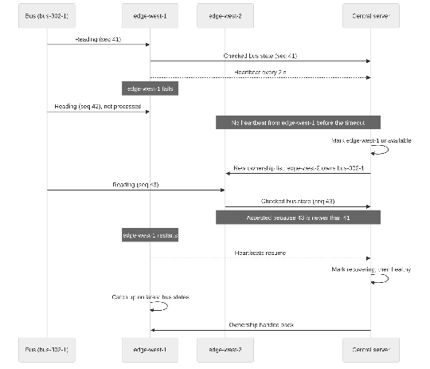
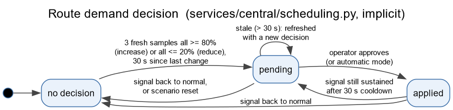

# A Fault-Tolerant, Edge-Assisted Public Transit System

SOFE 4790U Distributed Systems, Group 14, Final Project Report

| Team member | Student ID |
| :---- | :---- |
| Zachary Matasic | 100918415 |
| Lok Yung (Carson) Chan | 100926449 |
| Danial Shaikh | 100698628 |
| Ali Hakkani | 100867456 |
| Julian Olano Medina | 100855732 |

# Abstract

Public transit riders and operators both need live information they can trust: where a bus is, how full it is and when it will arrive. In this project we designed and built a simulated public transit system for Durham Region that uses distributed systems ideas to keep that information accurate and available.

The system has three tiers:

- Simulated buses send their location, speed and passenger counts over MQTT.
- Two regional edge servers per region check and process that data.
- A central server combines everything into one view of the network.

On top of this we built a passenger map, an operator dashboard, a bus health page and a control panel for running test scenarios.

To keep data in the right order we use per-bus sequence numbers and Lamport clocks instead of trusting each machine's clock. To keep the system running when parts fail, the central server watches heartbeats from every edge server and moves a failed server's buses to a healthy one. The central server also watches how full each route is and can send extra buses when a route stays crowded.

In our tests:

- No message was ever applied out of order, even during network outages.
- The system kept processing every reading after an edge server failed.
- Turning on demand scheduling raised the number of passengers who boarded from 25 to 89 in a matched four-minute run.

# Introduction

Reliable public transit depends on timely and accurate information for both riders and dispatchers. Riders need to know where their bus is and how crowded it is so they can plan their trip. Operators need the same information to react to traffic delays, sudden demand surges and vehicle or sensor faults, for example by dispatching more buses.

Current tracking falls short for two main reasons:

- **Unreliable delivery.** Vehicle telemetry travels over unstable connections, so updates can arrive late, arrive twice or be lost. If updates are applied in arrival order, or if every vehicle's clock is trusted as if there were no clock drift, outdated information can overwrite newer positions.
- **A single point of failure.** Routing every bus's telemetry into one central server creates a bottleneck. If that server stops, the whole network loses its information.

Addressing these limits needs a distributed architecture that does four things:

- separates vehicles from back-end services;
- validates telemetry close to where it is produced;
- orders updates without relying on physical clocks;
- keeps operating when individual servers or sensors fail.

Our goal was to design and simulate a public transit system that stays accurate and keeps working when parts of it fail. We had four main objectives from our proposal:

1. **Real-time bus tracking.** Live updates from every bus reach passengers and operators through publish-subscribe messaging.
2. **Demand-responsive scheduling.** Crowded routes get more buses and quiet routes get fewer.
3. **Fault tolerance and load balancing.** The failure of one regional server does not cut a region off.
4. **Correct event ordering.** A delayed or repeated message can never replace newer information.

This project is closely tied to the course. It uses:

- publish-subscribe communication through an MQTT broker;
- logical clocks and sequence numbers for ordering events;
- explicit assumptions about physical clock synchronization;
- heartbeats for failure detection;
- replication and ownership transfer for fault tolerance;
- load balancing between servers.

It also deals with the classic problems of message passing: messages that arrive late, arrive twice or never arrive, and servers that stop responding.

The rest of this report covers related work, the design and implementation of each part of the system, our evaluation and results, and ideas for future work.

# Related Work

Real-time transit information is already a common service, so we looked at how existing systems handle it before designing our own.

**GTFS Realtime.** Most transit agencies share live data using GTFS Realtime, a format created by Google \[1\]. A GTFS Realtime feed publishes vehicle positions, trip updates and service alerts that apps such as Google Maps can read. Durham Region Transit, whose routes and stops we used in our simulation, publishes its schedule data in the GTFS format \[9\]. GTFS Realtime is a data format, not a full system. It describes what a vehicle position looks like, but it does not say how an agency should check the data, order late updates, or keep its servers running when one fails. Each agency's back end has to handle those problems on its own.

**OneBusAway.** OneBusAway is an open source transit information system that started at the University of Washington \[2\]. It takes in an agency's schedule and real-time data and gives riders arrival times through a website, mobile apps and an API. Like most rider apps, it relies on one central back end that receives every vehicle update.

**The Transit app.** Transit is a popular commercial app that also shows live bus locations. When an agency's own real-time data is missing or poor, Transit can use location data shared by riders on the bus to improve its predictions \[3\]. This shows that real-time data is often incomplete, and that a good system has to deal with missing or uncertain information instead of hiding it.

**Techniques we borrowed:**

- **Edge computing \[4\].** Data is processed close to where it is created instead of being sent to one central place. This reduces the load on the central server and lets each region keep working on its own.
- **MQTT \[5\].** For messaging we used MQTT, a lightweight publish-subscribe protocol that is an OASIS standard, with the open source Mosquitto broker \[6\].
- **Lamport clocks \[7\].** We used Lamport's logical clocks to order events.
- **Cristian's algorithm \[8\].** We used it to estimate clock offsets between machines.

Table 1 compares our system with these existing tools. Existing rider apps mostly focus on showing data, while our project focuses on how the data is moved, checked, ordered and kept available behind the scenes. On the other hand, our system simulates one region with simulated buses, while the existing tools run on real fleets and serve real riders.

| Feature | GTFS Realtime feeds | Rider apps (OneBusAway, Transit) | Our system |
| :---- | :---- | :---- | :---- |
| Live bus locations | Yes, as a shared data format | Yes | Yes, from simulated buses |
| Where the data is processed | Each agency's own servers | One central back end | Regional edge servers, then a central server |
| Handling late or repeated updates | Timestamps in each message | Not described publicly | Per-bus sequence numbers and Lamport clocks |
| Server failure handling | Left to each agency | Not described publicly | Heartbeats and automatic takeover by another edge server |
| Schedule changes based on demand | Not covered | Not covered | Extra buses sent to routes that stay crowded |
| Scale | Real agencies around the world | Real riders in many cities | One simulated region, up to 50 buses |

*Table 1: Comparison of our system with existing transit information tools*

# Main Body of Work

## System Overview

The system has five parts, each with its own job:

- The buses produce data.
- The MQTT broker moves it.
- The edge servers check and process it.
- The central server stores it and makes network-wide decisions.
- The web pages show it to passengers and operators.

The parts talk to each other only through agreed message formats, MQTT topics and REST endpoints. Each part can therefore be developed, tested and replaced on its own. Figure 9 shows the full layout and Figure 10 shows how data moves between the parts.

**Map data.** We used real Durham Region Transit data: five routes, 373 stops and both travel directions for each route. We split the routes into two regions:

- **West** (Whitby, Ajax and Pickering): routes 302 and 900.
- **East** (Oshawa): routes 407, 409 and 901.

By default there are 20 buses, four per route. Each region has two active edge servers plus a standby third one.

**Run modes.** The system can run in two modes:

- **Live mode.** Separate bus programs publish real MQTT messages to separate edge server processes, and the central server saves the results in a PostgreSQL database.
- **Controlled demonstration mode.** The central server runs the same validation and processing code inside one process with a simulation clock.

We used the demonstration mode for repeatable tests and for showing failures and recovery on demand. It lets us break things on purpose without stopping real processes.

## Bus Simulation

Since we did not have access to real buses, we built a simulator that makes each bus act like a real vehicle:

- **Movement.** Each bus follows the ordered stops of its route. It moves at about 30 km/h in normal traffic and slows to 9 km/h in heavy traffic.
- **Stops.** It waits three seconds at each stop, where passengers get on and off.
- **Passengers.** Each bus has 50 seats. The number of passengers depends on the demand setting: peak demand fills buses up, while off-peak demand leaves them mostly empty.

**Readings.** Every second, a bus sends a reading with these fields:

- bus ID, city, region and route;
- GPS position, speed and direction;
- number of passengers and seats;
- current and next stop;
- the time the reading was made;
- a sequence number and a Lamport clock value;
- bus status and sensor status.

The sequence number goes up by one with every reading. This is what later lets the edge and central servers spot old or repeated messages.

**Phases and sensors.** Buses go through realistic phases around each stop: travelling, arriving, stopped, boarding and departing (Figure 21). They can also be taken out of service. Separately from their readings, buses send heartbeats every two seconds for four sensors: GPS, speed, stop status and passenger count. If a sensor fails, the bus reports the failure instead of making up a value. For example, if the passenger counter breaks, the bus keeps sending its location but marks the occupancy as faulty.

**Repeatability.** The simulator supports fleets of 5, 10, 20, 25 and 50 buses, and new buses can be added through a configuration object. Operators can pause and resume buses, change demand and traffic, and turn on sensor failures. The scenarios use fixed random seeds, so running the same scenario twice gives the same results. This made our tests and comparisons fair.

## MQTT Messaging and Event Ordering

**Topics.** All communication between buses, edge servers and the central server goes through a Mosquitto MQTT broker. MQTT uses publish-subscribe, so a bus does not need to know which server will read its data. It publishes to a topic for its region and bus, such as `transit/buses/west/bus-302-1/telemetry`, and the edge servers for that region subscribe to it. Edge servers publish checked bus states on a separate topic for the central server. There are also topics for heartbeats, alerts, commands and ownership assignments. Because of this, new buses or servers can be added without changing the others.

**Ordering.** We send every message with QoS 1, which means at-least-once delivery. A message is not silently dropped while the connection is up, but it can arrive late or more than once. So instead of trusting the order messages arrive in, every reading carries three pieces of ordering information:

- **Sequence number.** This decides whether a reading is accepted. The edge and central servers only accept a reading if its sequence number is higher than the last one they accepted for that bus.
- **Lamport clock.** This orders events across different processes without trusting their wall clocks. Every process adds one to its clock when it sends a message. When it receives a message, it sets its clock to the larger of its own value and the received value, plus one.
- **Timestamp.** This is the real time the reading was made. It is only used for display and is never used to accept or reject a message.

**Lost connections.** If a bus loses its connection, it keeps generating readings and holds up to 1,000 of them in memory. It resends them in their original order when it reconnects.

While testing this, we found a real ordering bug. The MQTT library reported the bus as reconnected before it finished resending old messages. A brand new reading could therefore get ahead of older ones and cause them to be rejected as stale. We fixed this by holding new readings back until all the older ones are acknowledged.

**Publisher state machine.** To make this rule easy to check, the publisher's connection is an explicit state machine with five states (Figure 18):

- connecting;
- online;
- resending;
- offline;
- closed.

A reading goes straight to the broker only in the online state. In every other state it waits in a local backlog, which a background thread sends in order once the connection is back online and every older reading has been acknowledged. The allowed transitions are listed in one table in the code, and a unit test drives the publisher through every state.

**Physical clocks.** We assume every machine is kept within two seconds of real time, for example with NTP. Ordering never depends on the timestamp, so a wrong clock only makes the displayed time misleading; it does not corrupt the data. We tested this with simulated clocks that were several seconds off, drifting, or even years wrong, and the ordering still worked. We also implemented Cristian's algorithm to estimate the offset between two machines. In our analysis we used vector clocks to tell apart events that happened one after another from events that were concurrent.

**Alerts and commands.** These also travel over MQTT:

- Buses send alerts when a sensor fails or recovers.
- Edge servers send an alert when their queue is full.
- Operators can send commands to one bus or a whole region, for example to pause buses or change traffic.

Each command has a unique ID, so it is applied only once even if it is delivered twice. A bus is running, paused or stopped (Figure 19). Stopped is final, so a late resume command cannot restart a bus that is shutting down.

**Broker security.** On the secured version of our broker, every service has its own account and can only publish and subscribe to its own topics. A bus therefore cannot pretend to be another bus or send a command.

## Regional Edge Servers

Each region has two active edge servers that share the buses in that region, and a third standby server that can be started when both are busy. An edge server is the first place where bus data is checked.

**Checking a reading.** When a reading arrives, the edge server:

1. checks the message signature to confirm it came from that bus;
2. converts it into the shared format if needed (our normal JSON format, a different vendor JSON format, or CSV);
3. validates it, rejecting things like impossible GPS positions, negative speeds, more passengers than seats, unknown buses, or a bus claiming to be in the wrong region;
4. checks that it is actually the owner of that bus.

**Processing.** Accepted readings go into a queue that holds at most 50 waiting messages, so a flood of data cannot use up all of the server's memory. The edge server then processes each reading:

- It calculates how full the bus is and gives it a crowding level of low, medium or high, with cut-offs at 50% and 80%.
- It works out how far along the route the bus is.
- It saves the latest state of every bus in a cache.

Old, duplicate or conflicting readings are rejected at this point, so they never overwrite newer data. Only new, accepted states are sent on to the central server.

**Health.** Edge servers track the heartbeats of every sensor on their buses. They also send their own heartbeat to the central server every two seconds, along with how full their queue is. This lets the central server notice when an edge server stops responding. Figure 16 shows how a heartbeat source moves between unknown, healthy, recovering and unavailable.

**Failover.** When an edge server fails, its buses need a new owner:

- In the controlled demonstration, every accepted bus state is copied to the other edge servers, so a healthy server already has the latest data when it takes over.
- Each bus has an ownership version number that goes up every time its owner changes. An old owner that comes back therefore cannot overwrite data from the new owner.
- A recovering server first catches up on the latest state and only gets buses back after that.
- If both servers in a region fail, a healthy server in the other region can take over that region's buses.

Figure 17 shows the edge server lifecycle and Figure 11 shows a failure and recovery as a sequence of messages.

**Load balancing.** Normally, buses are split evenly between the two servers in a region. If both servers' queues stay at least 70% full for six seconds, the standby third server synchronizes and takes part of the work. When the load drops again, it hands the buses back and returns to standby.

## Central Server and Scheduling

The central server is the top of the system's hierarchy. It:

- stores and reads data in the PostgreSQL database;
- monitors the health of the other components;
- checks every bus state before ingesting it;
- provides server-side services such as arrival-time estimates and trip planning.

It acts as the coordinator of the components and as the gateway between the edge servers and the users. Its API is built with FastAPI \[12\]. Some services are public, such as arrival estimates for the remaining stops of a bus. Others are for operators only, such as edge server health and simulation control.

### Arrival times

Arrival times are computed by following the route rather than measuring straight-line distance to the stop:

1. Starting from the bus's current stop, the server takes the great-circle (haversine) distance from the bus to the next stop.
2. It adds the distance of every route segment up to the target stop.
3. It divides the total by the bus's reported speed, or by a cruising speed when the bus is stopped.
4. It adds a three-second dwell time for every intermediate stop.

No estimate is returned, rather than a guessed one, when the stop is behind the bus, the stop is not on its route, or the speed is missing or invalid.

The server also checks its own accuracy. It records each next-stop prediction. When the bus is later observed stopped at that stop, it stores the difference between the predicted and actual arrival time. The operator pages show the mean absolute error of the last 100 predictions.

### Ingestion checks

Each bus state reaches the central server through an edge server, and not every message should be stored. Three things can make it wrong:

- a faulty sensor can report an illogical value, such as a wrong region or a stop that jumps backwards;
- a message can arrive late;
- after a server recovers, two edge servers can briefly both claim the same bus.

Before storing anything, the server validates the message against the `BusStateUpdate` schema and then checks five things in order:

1. The region in the message matches its topic.
2. The sequence number is newer than the last one stored for that bus.
3. The reported region matches the bus's assigned region.
4. The sending edge server is the bus's current owner.
5. The next stop is actually ahead of the bus on its route.

The ownership check matters after a failover: a recovered home server could otherwise send states for a bus it no longer owns, before it has read the new ownership list.

### Edge monitoring

All edge servers report their status through heartbeats. The central server accepts a heartbeat only if all of the following hold:

- it comes from a known edge server on the expected topic;
- its bus list has no duplicates and contains only valid buses;
- each bus reports its full set of sensors.

Each heartbeat carries a session ID and a sequence number. A delayed heartbeat from before a restart therefore cannot make a dead server look alive. The timeout is 10 seconds and is measured with a monotonic clock, so changes to the wall clock do not affect failure detection.

### Failover

An edge server is marked unavailable once no heartbeat has arrived for 10 seconds. The failover round runs every second, so it notices this within at most 11 seconds. It then works as follows:

- **Takeover.** Each of the failed server's buses is moved to the least-loaded healthy edge server in the same region. Ties are broken by edge ID.
- **No churn.** Only a confirmed failure moves buses. An edge whose status is still unknown or recovering keeps its buses, so a staggered start-up or a brief recovery does not cause buses to bounce between servers.
- **Publishing the change.** Every change increases the region's ownership epoch. The central server publishes the new assignment as a retained MQTT message, so an edge that restarts receives the current owner list immediately. It republishes every region's assignment whenever its own MQTT connection is restored.
- **Failback.** When the home edge server becomes healthy again, its buses are returned to it in the next round.

### Trip planning

Passengers can search for a trip between two stops:

- **Search.** The central server looks for direct buses and trips with one transfer. For each, it estimates the waiting time, riding time and total time.
- **Ranking.** It ranks the options by total time, how full the buses are and the number of transfers. Each transfer counts as an extra five minutes.
- **Seats.** Buses without enough free seats for the group are still listed but never recommended.
- **Explanation.** Each recommendation comes with a short explanation, such as how many minutes it takes and how many seats are free.

### Demand scheduling

The central server checks how full each route is every two seconds:

- **Increase service.** If three fresh samples in a row show a route at least 80% full, it recommends adding service.
- **Reduce frequency.** If three in a row show it at most 20% full, it recommends reducing frequency.
- **Cooldown.** After a change, it waits 30 seconds before making another decision for that route, so one unusual reading cannot cause repeated changes.
- **Refresh.** A recommendation that waits more than 30 seconds for approval is replaced with a fresh one, so it never goes stale.

An operator can approve each decision, or switch on automatic mode. When a decision is approved in the demonstration, a reserve bus is dispatched on that route. The central server confirms the change when it sees that bus's readings arrive. Figure 20 shows this decision cycle.

### Access control

Passenger pages and passenger data are public. Every management action, such as failing a server or dispatching a bus, needs an operator login. These checks happen on the server, not just in the web page, and requests that come from other websites are rejected. The passenger data also hides internal details, such as which edge server owns a bus, and we do not store any personal information about passengers.

## User Interfaces

**Pages.** The user interface is a web application written in plain HTML, CSS and JavaScript. It uses Leaflet \[10\] and OpenStreetMap \[11\] for the map, and the central server serves the pages itself. Passengers and operators have separate pages, so passengers only see what they need and cannot reach any management controls. Every page asks the central server for new data every second, so bus movements and status changes show up without reloading.

**Development.** We built the first version of the pages using mock data shaped like the central server's responses. This let us work on the interface before the back end was ready; when the real APIs were done, we only had to switch the data source. Operators can still choose between the live MQTT data and the controlled demonstration from a menu on their pages.

**Untrusted text.** Text that comes from bus telemetry, such as the bus status, is HTML-escaped before it is shown. A compromised bus therefore cannot inject a script into a passenger's or operator's browser.

### Passenger Map

The passenger map is the page riders use. It shows the routes, stops and buses for the selected region, with each bus labelled by its route and coloured by how crowded it is.

**Planning a trip.** A passenger picks a region, chooses their stop and an optional destination, and enters how many people are travelling. The page then shows:

- the best option, including when the bus arrives, how long the trip takes, how full the bus is and how many seats are free;
- a list of buses arriving at that stop.

**Clicking the map.** Passengers can also click anywhere on the map. The system checks the five closest stops to find a bus they can still walk to in time.

**Honest data.** We were careful not to show information as live when it is not. A bus that has not reported recently, or whose position is missing or invalid, is not shown as a live position. If no prediction can be made, the page says so, for example "No approaching buses with reliable predictions", instead of making up a time.

*Figure 1: Passenger map for the west region, showing routes 302 and 900 and the live buses*

<!-- Screenshot needed: trip search result -->
*Figure 2: Trip search showing the recommended bus, arrival time, trip time and free seats*

### Operator Login

Operator pages are protected by a login page. Anyone who opens an operator page without signing in is sent to the login page first. After signing in, operators can move between the dashboard, the bus health page and the control panel, and sign out when they are done.

<!-- Screenshot needed: login page -->
*Figure 3: Operator login page*

### Operator Dashboard

The operator dashboard gives a quick overview of the whole network:

- **Summary.** At the top it shows how many buses are live, how many are crowded, how many edge servers are healthy and how many alerts there are.
- **Alerts and buses.** Below that are the current alerts and a table of every bus with its route, status, speed, passengers, crowding level, last update and sensor health.
- **Routes.** A table lists the routes with their average occupancy.
- **Edge servers and events.** It shows every edge server's status, queue and assigned buses, plus recent events such as failures, recoveries and buses being moved between servers.

Problems are colour-coded, so a crowded route or a failed server stands out right away.

<!-- Screenshot needed: dashboard -->
*Figure 4: Operator dashboard with the network summary, alerts and bus table*

### Bus Health Page

The bus health page is a read-only page for looking at one bus, route or sensor in detail. The operator picks a region, route, bus and sensor. The page then shows:

- whether that sensor is healthy, faulty or unavailable;
- how old the last valid reading is;
- which edge server owns the bus;
- the queue load on each edge server.

It keeps an unknown state separate from a confirmed fault, so a server that stopped reporting is not mistaken for a broken sensor.

<!-- Screenshot needed: health page -->
*Figure 5: Bus health page showing edge server queues and sensor status*

### Control Panel

The control panel is where operators change the simulation.

**One-click scenarios.** The top of the page has a button for each feature we want to demonstrate:

- normal service and 50 active buses;
- load balancing and edge takeover;
- sensor fault, traffic delay and peak demand;
- the scheduling loop;
- a central server outage and recovery;
- an access security check.

**Manual settings.** Below the scenarios, operators can:

- set the demand for each route and change the fleet size;
- register and dispatch buses, and apply conditions to a single bus;
- fail or recover edge servers;
- send bursts of requests to test load;
- change the simulation speed.

If a command is not valid, the page shows a clear error message from the server instead of failing silently.

<!-- Screenshot needed: control panel -->
*Figure 6: Control panel with the one-click demonstration scenarios*

# Evaluation

Our evaluation looks at four properties: correct ordering and delivery of messages, behaviour under failure and load, the effect of demand scheduling, and security. Each part was first tested on its own through its agreed contract (message schemas, MQTT topics or REST API), then the whole system was tested together.

## Testing

The full automated suite has 506 tests. In our latest run, 487 passed and the other 19 were skipped because they need separate live services, such as a dedicated broker or database.

**Live broker tests.** We ran the messaging live tests separately against three real Mosquitto brokers:

- a plain broker;
- one that the test stops and restarts;
- the secured broker with passwords and access control lists.

All 168 messaging and broker-authentication tests passed, including the 15 that need a live broker.

**Other testing.** The database tests were run against PostgreSQL with four separate edge server processes. We also tested the web pages in a browser, including trip searches, operator login, the dashboard, the health page and the control panel scenarios.

## Message Delivery and Ordering Results

To measure messaging, we ran simulated buses as separate MQTT clients. Each bus sent five readings per second for 15 seconds, and we measured how long each message took to arrive. We tested three network conditions:

- a normal network;
- a network where every packet was held for 200 milliseconds;
- a three-second outage where every bus lost its connection.

Table 2 shows some of the results.

| Scenario | Buses | Sent | Received | Lost | Out of order | Median delay | Worst delay |
| :---- | :---- | :---- | :---- | :---- | :---- | :---- | :---- |
| Normal | 10 | 750 | 750 | 0 | 0 | 1.3 ms | 4.4 ms |
| 200 ms delay | 10 | 750 | 750 | 0 | 0 | 2.3 ms | 233.9 ms |
| 3 s outage | 10 | 750 | 750 | 0 | 0 | 2.3 ms | 7.0 s |
| Normal | 50 | 3,750 | 3,750 | 0 | 0 | 2.0 ms | 25.3 ms |
| 3 s outage, default broker queue | 50 | 3,750 | 3,610 | 140 | 0 | 2.7 ms | 7.4 s |
| 3 s outage, larger broker queue | 50 | 3,750 | 3,750 (+1 duplicate) | 0 | 0 | 2.8 ms | 7.4 s |

*Table 2: Message delivery results for different numbers of buses and network conditions*

**Ordering.** In every run, including the outages, no message arrived out of order and no Lamport clock values were wrong.

**Delay.** With a normal network, messages arrived in about 2 milliseconds. During an outage, the worst delay was about 7 seconds. This comes from the 3-second cut plus the time the MQTT library waits before reconnecting.

**The one loss.** We found one loss, at 50 buses with an outage. All 50 buses resent about 1,400 saved messages at once. That was more than the broker's default limit of 1,000 queued messages for one subscriber, so 140 messages were dropped. Our tracking listed exactly which messages were lost, and raising the broker's limit to 10,000 removed the loss.

**Throughput.** A single Python subscriber can handle about 1,900 messages per second. That is enough for our setup, because each region has its own subscribers.

## Fault Tolerance and Scalability

To test the edge servers, we ran 20 rounds where every bus sent one reading per round, and we made edge-west-1 fail halfway through. We did this with 5, 10, 25 and 50 buses. Table 3 shows the results. In every case, all accepted readings were processed, and none were rejected or left waiting after the failure.

| Buses | Readings processed | Delay before failure (ms) | Delay after failure (ms) | Time to decide takeover (ms) | Buses on the surviving west server |
| :---- | :---- | :---- | :---- | :---- | :---- |
| 5 | 100 | 6 | 7 | 0.44 | 2 |
| 10 | 200 | 9 | 11 | 1.17 | 4 |
| 25 | 500 | 18.8 | 23.8 | 4.20 | 10 |
| 50 | 1,000 | 35 | 45 | 10.32 | 20 |

*Table 3: Edge server results with edge-west-1 failing halfway through each run*

The delay grows with the number of buses and goes up after a failure, because one server is doing the work of two. Even so, the system keeps processing everything. Deciding which server takes over took between half a millisecond and about ten milliseconds. These delays come from our simulation with a fixed 5 ms processing time per reading, not from a real network, so they show how the design behaves rather than how fast real hardware would be.

We also checked the full failure and recovery cycle in the browser:

1. After we failed an edge server from the control panel, the dashboard showed it as failed, raised an alert and listed the buses that moved to the other server.
2. After we recovered it, the server showed as recovering and then healthy again.

<!-- Screenshot needed: dashboard after takeover -->
*Figure 7: Operator dashboard after the edge takeover scenario*

## Demand Scheduling Results

To test scheduling, we ran matched four-minute simulations of route 302. Each started with one active bus, the same reserve buses and the same passenger demand. The only difference was whether scheduling was on.

- **Normal traffic.** Turning scheduling on:
  - increased the number of passengers who boarded from 25 to 89;
  - reduced the total waiting time slightly, from 817,328 to 814,071 passenger-seconds;
  - lowered average occupancy from 99.6% to 97.8%.
- **Heavy traffic.** Both runs boarded only 5 passengers in the same time, even though 8 extra buses were dispatched.

Extra buses help, but in heavy traffic they take longer than our short test window to reach the waiting passengers.

<!-- Screenshot needed: scheduling decision -->
*Figure 8: Scheduling decision for a crowded route during the peak demand scenario*

## Security and Privacy

- **Messaging.** Publishers can sign their messages, and edge servers reject unsigned, tampered or replayed messages.
- **Broker.** On the secured broker, anonymous logins and wrong passwords are refused, and each bus can only publish its own data.
- **Web.** Passengers can view public data without logging in. Every management action needs an operator login that is checked on the server. Text from bus telemetry is escaped before it is shown.
- **Privacy.** We do not store any passenger names or personal data.

There are still limits:

- The demo operator account uses a simple shared password, with a built-in default when none is configured.
- There is no HTTPS.
- Our container setup sends broker passwords over plain TCP inside the private container network.

## Usability and Transparency

**Usability.** We kept the passenger page simple: pick a stop and an optional destination, and get one recommended bus with a plain explanation. Uncertain information is labelled clearly instead of hidden, so passengers are never shown a made-up arrival time or a bus that is not really live. For operators, the dashboard, health page and control panel all read the same back-end data. A change made in the control panel therefore shows up on the other pages within a few seconds.

**Transparency.** The system is also transparent in the distributed systems sense. Passengers do not need to know which edge server handles their bus, or that a server failed and another one took over.

## Code Quality and Design Review

To check that the design described here matches what we built, we generated class diagrams directly from the code (Figures 12 to 15). We also reviewed the code for lifecycles that move through a fixed set of states (Figures 16 to 21).

**Explicit and implicit state machines.** The messaging layer now models its two lifecycles as explicit state machines: an enumeration of states plus a table of allowed transitions. These are the publisher's connection and a bus's simulation mode. Replacing four interacting flags with one state made the reconnect ordering rule easy to read and test. In the other components the states are still implicit: status strings, booleans, counters and timestamps changed in several places.

**Problems found and fixed.** Drawing the machines exposed three problems:

- **Stuck scheduling decision.** A recommendation that stayed pending for more than 30 seconds could never be approved, because it was never refreshed while demand stayed high.
- **Blocking work on the event loop.** The failover round and the simulation clock ran blocking work directly on the web server's event loop, so a long simulation step could pause every request, including failover. Both now run in a worker thread.
- **Unescaped bus status.** The bus status text was not escaped on the web pages.

After these changes the full test suite and the live broker tests passed again with the same results.

## Limitations

Our system is a classroom simulation, so it has some limits:

- **Coordination.** The takeover and replication in the controlled demonstration are run by one coordinator in memory. This is not a true distributed agreement protocol, and that state is lost if the central process restarts.
- **Scope.** We only modelled one city with two regions, and the buses are simulated rather than real.
- **Walking distances.** Distances to nearby stops are straight-line estimates.
- **Edge server lifecycle.** The lifecycle is implicit, and a failed or recovering edge server can be moved straight to standby, which skips the recovery checks.
- **Not production-ready.** The demo login and the lack of HTTPS mean the system is not ready for real public use.

# Conclusion

We built a simulated public transit system for Durham Region that keeps bus information accurate and available using distributed systems ideas. Buses publish their data over MQTT, regional edge servers check and process it, and a central server combines it, estimates arrivals, recommends trips and adjusts service based on demand. Passengers and operators use it through a passenger map, an operator dashboard, a bus health page and a control panel.

Our main contributions are:

- a three-tier design that spreads work across regions instead of sending everything to one server;
- an ordering approach using sequence numbers and Lamport clocks, enforced by an explicit publisher state machine, that kept every message in order in our tests;
- automatic failure detection and takeover between edge servers;
- demand-based scheduling that dispatches extra buses to crowded routes;
- an interface that clearly shows when information is uncertain.

Our results showed three things:

- Messages were never applied out of order, even during outages.
- The system kept processing every reading when an edge server failed.
- Scheduling more than tripled the number of passengers who boarded in our normal traffic test.

The team divided the work by component, as shown in Table 4.

| Team member | Main responsibility | Share of work |
| :---- | :---- | :---- |
| Zachary Matasic | Bus simulation: routes, movement, passenger demand, sensor faults and repeatable scenarios | TBD |
| Julian Olano Medina | MQTT messaging: broker setup, topics, Lamport clocks, reconnection handling, alerts, commands, broker security, and the code review behind Figures 12 to 21 | TBD |
| Ali Hakkani | Regional edge servers: validation, processing, heartbeats, failover, load balancing and scaling | TBD |
| Lok Yung (Carson) Chan | Central server: database, APIs, ingestion checks, edge monitoring, arrival times, trip planning and scheduling | TBD |
| Danial Shaikh | User interfaces: passenger map, operator dashboard, bus health page, control panel and report diagrams | TBD |

*Table 4: Contribution matrix*

# Schematic

Figure 9 shows the overall layout of the system:

- Buses in each region publish their readings to the MQTT broker.
- The two edge servers for that region read those readings, check and process them, and publish the accepted bus states back through the broker to the central server.
- The central server stores the states in PostgreSQL and monitors the edge servers through their heartbeats.
- It sends ownership updates to the edge servers and commands to the buses.
- It serves the web pages and APIs used by passengers and operators.

*Figure 9: System schematic*

# Design Diagrams

## Data Flow and Failover

Figure 10 shows how data moves through the system, from the simulated buses, through the MQTT broker and the regional edge servers, to the central server and finally the web pages. Solid arrows carry data upwards; dashed arrows carry control messages back down. The pages request new data from the central server every second over REST.

*Figure 10: Data flow from the simulated buses to the web interfaces*

Figure 11 shows what happens when an edge server fails and later recovers.

*Figure 11: Edge server failure, takeover and recovery*

## Class Diagrams

We generated class diagrams directly from the code with pyreverse, the UML tool in pylint \[13\], and rendered them with Graphviz. They show the classes and public members of each tier. Our components mostly talk to each other through functions, MQTT topics and JSON schemas rather than object references, so few associations appear between classes. This matches the loose coupling described in the System Overview.

*Figure 12: Classes of the messaging layer (services/messaging)*

*Figure 13: Classes of the regional edge servers (services/edge)*

*Figure 14: Classes of the central server (services/central)*

*Figure 15: Shared schemas and the bus simulator (shared/schema, services/data_simulation)*

## State Machines

Figures 18 and 19 are explicit in the code. The others are implicit and are drawn from how the code behaves.

*Figure 16: Liveness of an edge server or bus sensor, derived from heartbeats (10 s timeout, 4 s recovery window)*

*Figure 17: Lifecycle of an edge server in the controlled demonstration, including standby, takeover and recovery*

*Figure 18: Connection states of the bus publisher, which keep readings in order across a reconnect*

*Figure 19: Simulation mode of a bus, changed by MQTT commands*

*Figure 20: Demand scheduling decision for one route*

*Figure 21: Movement phase of a simulated bus around a stop*

# Future Work

There are several ways we would like to improve this system:

- **Real data.** Connect to Durham Region Transit's real-time feed, so the system runs on real bus positions instead of simulated ones.
- **Replicated coordination.** Replace the single in-memory coordinator with a proper replicated agreement protocol, so ownership and bus state would survive the loss of any one server, including the central one.
- **Explicit edge lifecycle.** Make the remaining implicit state machines explicit, starting with the edge server lifecycle (Figure 17). A transition table like the one in our publisher would reject the failed-to-standby path that currently skips the recovery checks.
- **Safety and usability:**
  - HTTPS and TLS for the broker;
  - real operator accounts with different roles instead of one demo login;
  - a mobile version of the passenger page;
  - walking directions that follow real streets.
- **Predictive scheduling.** Our scheduler only reacts to crowding that is already happening. It could use past data to predict busy times and add buses before routes get crowded.
- **More cities.** Extend the system to more than one city.

# References

\[1\] Google, "GTFS Realtime Overview," Google for Developers. \[Online\]. Available: https://developers.google.com/transit/gtfs-realtime

\[2\] OneBusAway, "The OneBusAway Application Suite," GitHub. \[Online\]. Available: https://github.com/OneBusAway/onebusaway-application-modules

\[3\] K. Korosec, "Transit app begins crowdsourcing data to provide accurate, real-time info," TechCrunch, Dec. 20, 2016. \[Online\]. Available: https://techcrunch.com/2016/12/20/transit-app-begins-crowdsourcing-data-to-provide-accurate-real-time-info/

\[4\] W. Shi, J. Cao, Q. Zhang, Y. Li and L. Xu, "Edge Computing: Vision and Challenges," IEEE Internet of Things Journal, vol. 3, no. 5, pp. 637-646, 2016.

\[5\] OASIS, "MQTT Version 5.0," OASIS Standard, 2019. \[Online\]. Available: https://docs.oasis-open.org/mqtt/mqtt/v5.0/mqtt-v5.0.html

\[6\] R. A. Light, "Mosquitto: server and client implementation of the MQTT protocol," Journal of Open Source Software, vol. 2, no. 13, p. 265, 2017.

\[7\] L. Lamport, "Time, Clocks, and the Ordering of Events in a Distributed System," Communications of the ACM, vol. 21, no. 7, pp. 558-565, 1978.

\[8\] F. Cristian, "Probabilistic clock synchronization," Distributed Computing, vol. 3, no. 3, pp. 146-158, 1989.

\[9\] Region of Durham, "Durham Region Transit GTFS data." \[Online\]. Available: https://maps.durham.ca/OpenDataGTFS/GTFS_Durham_TXT.zip

\[10\] Leaflet, "Leaflet: an open-source JavaScript library for interactive maps." \[Online\]. Available: https://leafletjs.com/

\[11\] OpenStreetMap contributors, "OpenStreetMap." \[Online\]. Available: https://www.openstreetmap.org/

\[12\] FastAPI, "FastAPI." \[Online\]. Available: https://fastapi.tiangolo.com/

\[13\] PyCQA, "Pyreverse: UML diagram generator," pylint documentation. \[Online\]. Available: https://pylint.readthedocs.io/en/latest/additional_tools/pyreverse/index.html
