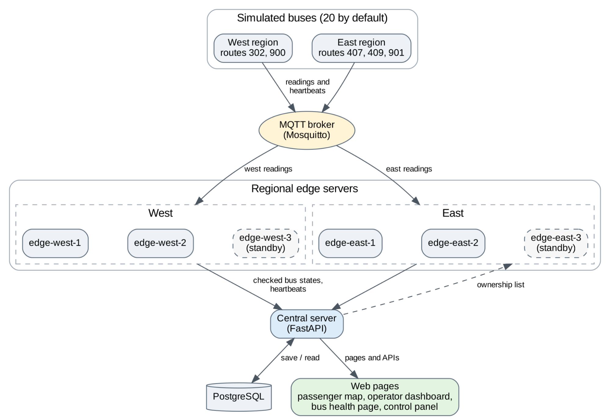
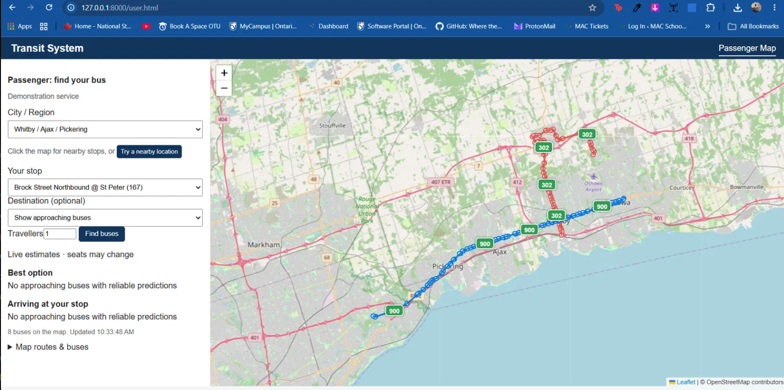
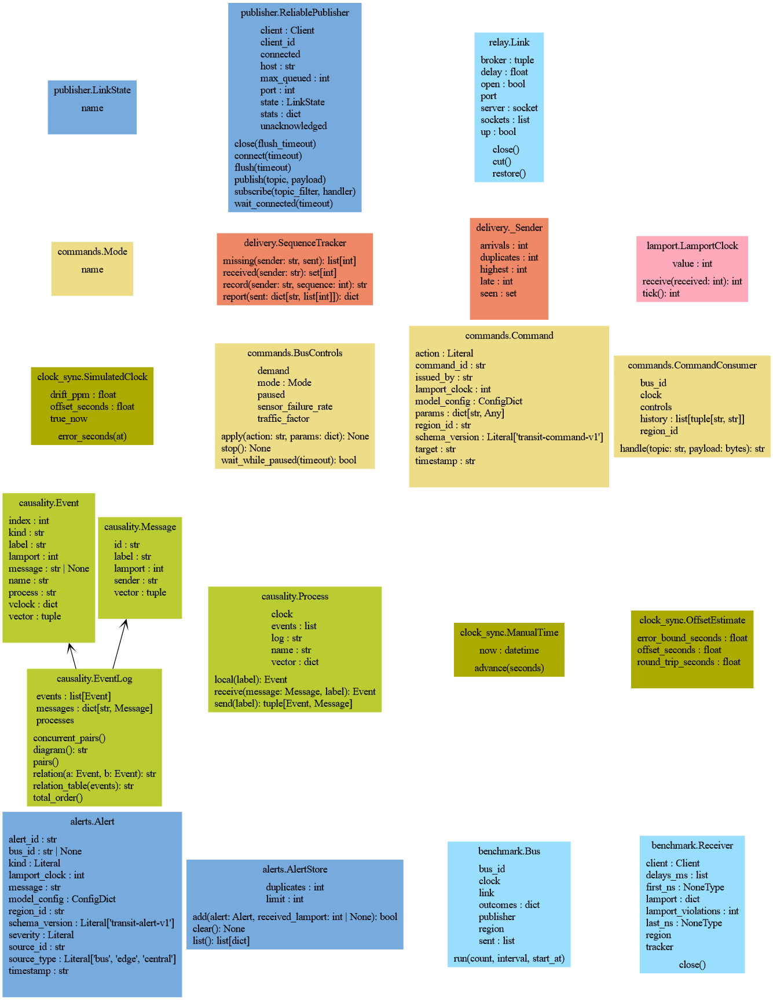
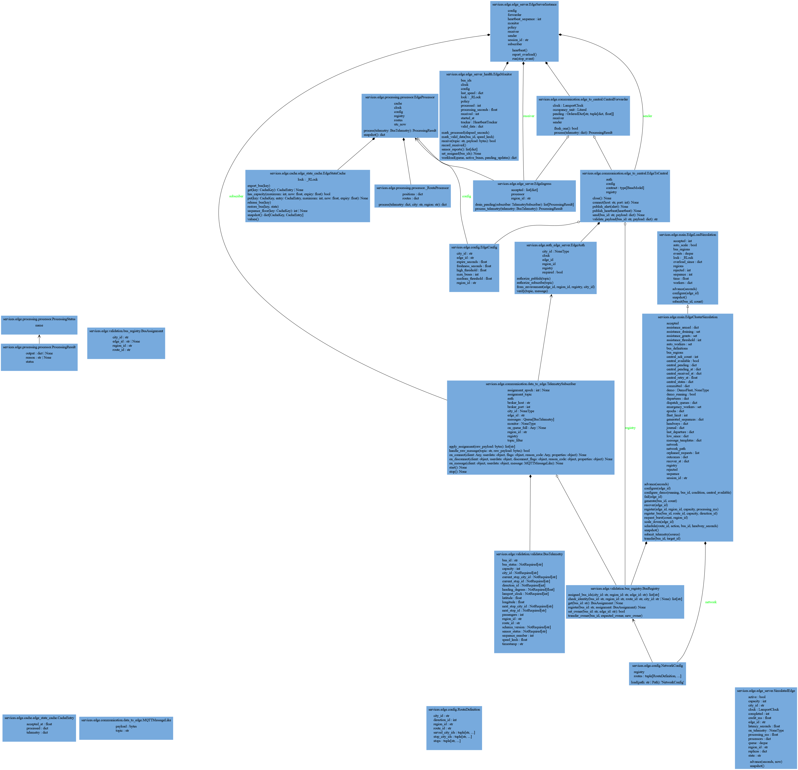
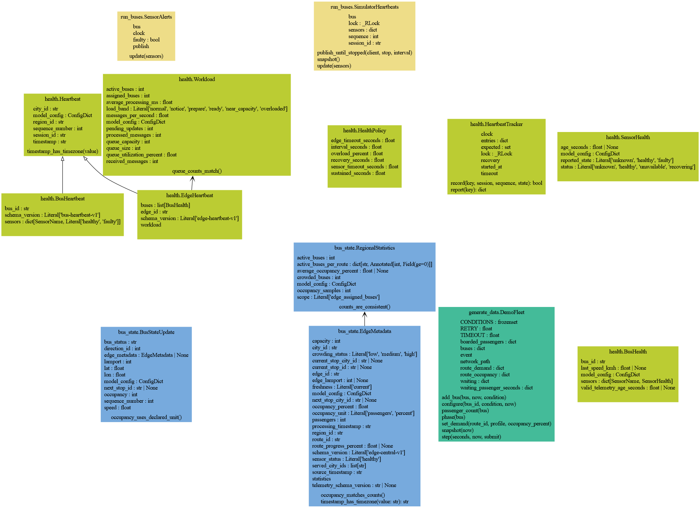
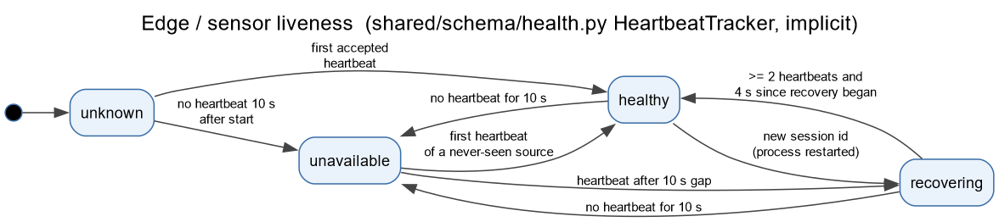
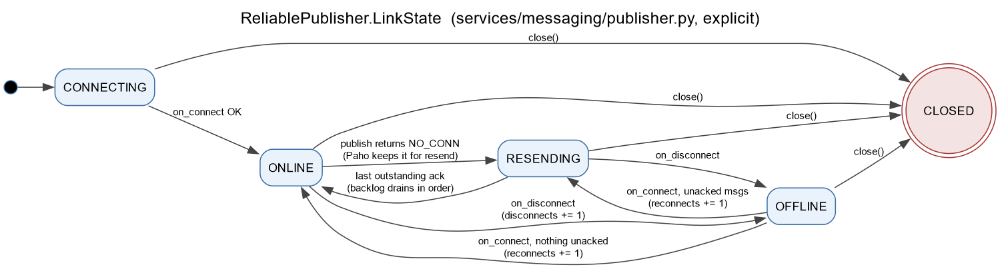
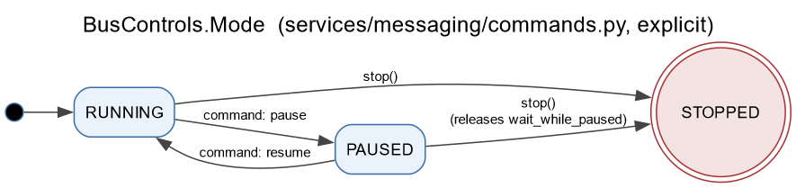

Faculty of Engineering & Applied Science

Distributed Systems, SOFE 4790U

November 25th, 2026

# A Fault-Tolerant, Edge-Assisted Public Transit System

Final Project Report, Group 14

| Team member | Student ID |
| :---- | :---- |
| Zachary Matasic | 100918415 |
| Lok Yung (Carson) Chan | 100926449 |
| Danial Shaikh | 100698628 |
| Ali Hakkani | 100867456 |
| Julian Olano Medina | 100855732 |

# Abstract

Riders and operators of a public transit network both depend on live information they can trust: where a bus is, how full it is, and when it will arrive. This report presents a simulated public transit system for Durham Region Transit (DRT) that applies distributed systems principles to keep that information accurate and available when the network or individual servers fail.

The architecture spans three tiers. Simulated buses publish location, speed and occupancy telemetry over MQTT. Two active regional edge servers per region then validate, order and process that data, and a central server aggregates network state, computes arrival estimates, and coordinates failover and scheduling. Four web interfaces are built on top of this pipeline: a passenger map, an operator dashboard, a bus health page and a scenario control panel.

Event ordering does not rely on synchronized physical clocks. Instead, per-bus sequence numbers and Lamport clocks determine which update is the newest. Availability is maintained by the central server, which monitors edge heartbeats against a monotonic clock and transfers a failed edge server's buses to a healthy peer. The central server also evaluates route occupancy every two seconds, and dispatches reserve buses when a route remains crowded.

Evaluation produced three primary findings:

1. **No ordering violations.** Across all 10- and 50-bus messaging tests, including a 200 ms artificial delay and a 3-second outage of the whole fleet, no message was applied out of order and no Lamport clock value was incorrect.
2. **Continuous processing during failures.** When an edge server failed mid-run with fleets of 5 to 50 buses, every accepted reading was still processed, and takeover decisions took between 0.44 ms and 10.32 ms.
3. **Scheduling gains bounded by traffic.** In matched four-minute runs in normal traffic, demand scheduling raised the number of boarded passengers from 25 to 89. In heavy traffic, the dispatched reserve buses could not reach waiting passengers within the four-minute window, which shows the limit of purely reactive dispatch.

# 1. Introduction

Reliable public transit depends on timely and accurate information for both riders and dispatchers. Riders need live vehicle locations and crowding levels to plan a trip, while operators rely on the same information to respond to traffic delays, demand surges, and vehicle or sensor faults.

Conventional tracking architectures have two structural weaknesses. First, vehicle telemetry travels over unstable wireless links, so updates can arrive late, arrive twice, or be lost entirely. If updates are applied in arrival order, or if every vehicle's clock is trusted as though clock drift did not exist, outdated positions can overwrite newer ones. Second, routing every bus's telemetry into one central server creates a bottleneck and a single point of failure, which leaves the entire network without information if that server stops.

Addressing these limits requires a distributed architecture that decouples vehicles from back-end services through publish-subscribe messaging, validates telemetry at regional edge servers close to the source, orders events logically instead of by physical clocks, and keeps operating when individual servers or sensors fail.

This project designs, implements and evaluates such a system, simulated for a single municipality (Durham Region, up to 50 buses). The project proposal established four objectives:

1. **Real-time bus tracking.** Live updates from every bus reach passengers and operators through publish-subscribe messaging.
2. **Demand-responsive scheduling.** Crowded routes receive reserve buses, and quiet routes receive fewer.
3. **Fault tolerance and load balancing.** The failure of one regional server does not cut a region off, and extra capacity is added under sustained load.
4. **Correct event ordering.** A delayed or repeated message can never replace newer information.

The implementation applies six course concepts: publish-subscribe messaging through an MQTT broker, Lamport clocks and sequence numbers, explicit assumptions about physical clock synchronization, heartbeat-based failure detection, replication with ownership transfer, and load balancing between servers. It also confronts the classic problems of message passing: messages that arrive late, arrive twice or never arrive, and servers that stop responding.

The remainder of this report is organized as follows. Section 2 compares this architecture with existing transit tools, and Section 3 details the design and implementation of each component. Section 4 evaluates message ordering, failover, scheduling, security and code quality. Section 5 summarizes the project's contributions and the division of work, and Section 6 outlines extensions toward a production system. The class diagrams and state machines appear in Appendices A and B.

# 2. Related Work

Before designing this architecture, the team reviewed three established real-time transit technologies and four foundational distributed systems techniques.

**GTFS Realtime.** Most transit agencies publish live data using GTFS Realtime, a format created by Google \[1\]. A GTFS Realtime feed exposes vehicle positions, trip updates and service alerts that applications such as Google Maps can read, and Durham Region Transit publishes its schedule data in the GTFS format \[9\]. However, GTFS Realtime is a data format rather than a complete system. It defines what a vehicle position looks like, but leaves validation, the handling of late updates, and server failover to each agency's own back end.

**OneBusAway.** OneBusAway is an open source transit information system that originated at the University of Washington \[2\]. It ingests an agency's schedule and real-time data, and provides arrival predictions through a website, mobile applications and an API. Like most rider applications, it relies on a single central back end that receives every vehicle update.

**The Transit app.** Transit is a commercial rider application that, when an agency's own real-time data is missing or of poor quality, supplements it with location data shared by riders on the bus \[3\]. Its design underlines an important reality: live telemetry is often incomplete, so a trustworthy interface must show uncertainty rather than hide it.

**Adopted techniques.** Four established techniques form the technical foundation of this design. Edge computing \[4\] processes data close to where it is created, which reduces the load on the central server and lets each region operate independently. Messaging uses MQTT \[5\], a lightweight publish-subscribe protocol and OASIS standard, through the open source Mosquitto broker \[6\]. Events are ordered across processes with Lamport's logical clocks \[7\] rather than physical timestamps, and Cristian's algorithm \[8\] is used to estimate clock offsets between machines.

Table 1 compares this system with the existing tools. Existing tools focus on presenting data to riders at real-world scale, whereas this project focuses on how the data is moved, validated, ordered and kept available behind the scenes. The caveat is scale: this system simulates one region with up to 50 buses, while the existing tools run on real fleets and serve real riders.

| Capability | GTFS Realtime (data format) | Rider apps (OneBusAway, Transit) | This system |
| :---- | :---- | :---- | :---- |
| Live vehicle positions | Shared data format | Presented to riders | Simulated fleet telemetry |
| Where data is processed | Each agency's own back end | One central back end | Regional edge servers, then a central server |
| Late or repeated updates | Timestamps in each message | Not described publicly | Per-bus sequence numbers and Lamport clocks |
| Server failure handling | Left to each agency | Not described publicly | Heartbeats and automatic edge takeover |
| Demand-based scheduling | Not covered | Not covered | Reserve buses dispatched to crowded routes |
| Scale | Agencies around the world | Real riders in many cities | One simulated region, up to 50 buses |

*Table 1: Comparison of this system with existing transit information tools*

# 3. System Architecture and Implementation

This section is divided into six parts. Section 3.1 presents the overall layout and operating modes, Section 3.2 describes the bus simulator, and Section 3.3 covers MQTT messaging and event ordering. Section 3.4 then details the regional edge servers, Section 3.5 explains the central server and scheduling, and Section 3.6 describes the passenger and operator interfaces.

## 3.1 System Overview

The system consists of five components, each with a distinct responsibility. Simulated buses generate telemetry, the MQTT broker routes messages, regional edge servers validate and process readings, the central server stores state and makes network-wide decisions, and the web interfaces serve passengers and operators. Because the components interact only through agreed JSON message formats, MQTT topics and REST endpoints, each one can be developed, tested and replaced independently.

Figure 1 shows the overall layout. Buses in each region publish their readings to the MQTT broker. The two edge servers for that region read, validate and process those readings, and publish the accepted bus states back through the broker to the central server. The central server stores these states in PostgreSQL and monitors the edge servers through their heartbeats. In the other direction, it sends ownership updates to the edge servers and commands to the buses, and it serves the web pages and APIs used by passengers and operators.

*Figure 1: System schematic*

Figure 2 traces how data moves through the system. Solid arrows carry telemetry upwards, while dashed arrows carry control messages back down. The web pages request new data from the central server every second over REST.

*Figure 2: Data flow from the simulated buses to the web interfaces*

**Map data.** The simulation uses real DRT GTFS data: five routes, 373 stops, and both travel directions for each route. These routes are split into two regions. The West region (Whitby, Ajax and Pickering) serves routes 302 and 900, while the East region (Oshawa) serves routes 407, 409 and 901. By default, 20 buses are in service (four per route), and each region has two active edge servers plus a standby third.

**Run modes.** The system runs in either live mode or controlled demonstration mode. In live mode, separate bus programs publish real MQTT messages to separate edge server processes, and the central server saves the results in PostgreSQL. In controlled demonstration mode, the central server runs the same validation and processing code within a single process driven by a simulation clock. This allows failures and recoveries to be triggered on demand and repeated exactly, without stopping real processes.

## 3.2 Bus Simulation

Since real buses were not available, a deterministic simulator makes each bus behave like a real vehicle. Each bus follows the ordered stops of its route at about 30 km/h in normal traffic, slowing to 9 km/h in heavy traffic, and waits three seconds at each stop while passengers board and alight. Each bus has 50 seats, and its passenger count depends on the demand setting: peak demand fills buses, while off-peak demand leaves them mostly empty.

Every second, each bus sends a JSON reading that falls into three groups of fields. Identity and movement fields give the bus ID, city, region, route, GPS position, speed and direction. Route and occupancy fields give the passenger count, seat capacity, current stop and next stop. Ordering and health fields give the time the reading was made, a sequence number that increases by one with every reading, a Lamport clock value, the bus status and the sensor status. The sequence number is what later allows the edge and central servers to identify old or repeated messages.

Around each stop, buses move through five phases: travelling, arriving, stopped, boarding and departing (Appendix B, Figure B6). They can also be taken out of service. Separately from their readings, buses send heartbeats every two seconds for four sensors: GPS, speed, stop status and passenger count. When a sensor fails, the bus reports the failure rather than inventing a value. For example, if the passenger counter breaks, the bus continues to send its location but marks its occupancy as faulty.

The simulator supports fleets of 5, 10, 20, 25 and 50 buses, and new buses can be added through a configuration object. Operators can pause and resume buses, change demand and traffic, and enable sensor failures. Because every scenario uses a fixed random seed, running the same scenario twice produces the same results, which keeps comparisons during evaluation fair.

## 3.3 MQTT Messaging and Event Ordering

All communication between buses, edge servers and the central server passes through a Mosquitto MQTT broker. Buses publish to a topic for their region and bus, such as `transit/buses/west/bus-302-1/telemetry`, and the edge servers for that region subscribe to it. Edge servers in turn publish validated bus states on a separate topic for the central server, while further topics carry heartbeats, alerts, commands and ownership assignments. Because a publisher never needs to know who reads its data, buses and servers can be added without changing the others.

Every message is sent with QoS 1, which guarantees at-least-once delivery. A message is therefore not silently dropped while the connection is up, but it can arrive late or more than once. Rather than trusting arrival order, every reading carries three pieces of ordering information:

1. **Sequence number.** This decides whether a reading is accepted. The edge and central servers accept a reading only if its sequence number is higher than the last one they accepted for that bus.
2. **Lamport clock.** This orders events across processes without trusting their wall clocks. Every process increments its clock when it sends a message, and on receiving one sets its clock to the larger of its own value and the received value, plus one.
3. **Timestamp.** This records the real time the reading was made. It is used only for display, and never to accept or reject a message.

**Lost connections.** If a bus loses its connection, it continues generating readings, holds up to 1,000 of them in memory, and resends them in their original order once it reconnects. The caveat to this approach surfaced during testing. The MQTT library reported the bus as reconnected before it had finished resending old messages, so a brand new reading could overtake older ones and cause them to be rejected as stale. The fix was to hold new readings back until every older reading has been acknowledged.

**Publisher state machine.** To make this rule easy to verify, the publisher's connection is modelled as an explicit state machine with five states: connecting, online, resending, offline and closed (Appendix B, Figure B3). A reading goes straight to the broker only in the online state. In every other state it waits in a local backlog, which a background thread sends in order once the connection is back online and every older reading has been acknowledged. The allowed transitions are defined in a single table in the code, and a unit test drives the publisher through every state.

**Physical clocks.** The design assumes that every machine is kept within two seconds of real time, for example with NTP. Because ordering never depends on the timestamp, an incorrect clock only makes the displayed time misleading; it does not corrupt the data. This was tested with simulated clocks that were several seconds off, drifting, or even years wrong, and ordering remained correct in every case. Cristian's algorithm was also implemented to estimate the offset between two machines, and vector clocks were used in the analysis to distinguish events that happened one after another from events that were concurrent.

**Alerts and commands.** Control messages also travel over MQTT. Buses send alerts when a sensor fails or recovers, edge servers send an alert when their queue is full, and operators send commands to a single bus or a whole region, such as pausing buses or changing traffic. Each command carries a unique ID, so it is applied only once even if it is delivered twice. A bus is always in one of three modes: running, paused or stopped (Appendix B, Figure B4). Stopped is final, so a late resume command cannot restart a bus that is shutting down.

**Broker security.** On the secured broker, every service has its own account and access control list, and may only publish and subscribe to its own topics. Consequently, a bus cannot impersonate another bus or issue a command.

## 3.4 Regional Edge Servers

Each region has two active edge servers that share the buses in that region, along with a standby third server that can be started when both are busy. An edge server is the first point at which bus data is validated. When a reading arrives, the edge server performs four checks in order:

1. **Signature.** It verifies the message signature to confirm that the reading came from that bus.
2. **Format.** It converts the payload into the shared format if needed (the standard JSON format, a different vendor JSON format, or CSV).
3. **Validity.** It rejects impossible GPS positions, negative speeds, more passengers than seats, unknown buses, and buses claiming to be in the wrong region.
4. **Ownership.** It confirms that it is currently the owner of that bus.

**Processing.** Accepted readings enter a queue that holds at most 50 waiting messages, so a flood of data cannot exhaust the server's memory. For each reading, the edge server calculates occupancy and assigns a crowding level: low below 50%, medium from 50% up to 80%, and high at 80% or above. It also determines how far along the route the bus has travelled, and stores the latest state of every bus in a cache. Old, duplicate or conflicting readings are rejected at this stage, so only new, accepted states are forwarded to the central server.

**Health and load balancing.** Edge servers track the heartbeats of every sensor on their buses, and send their own heartbeat, including their queue load, to the central server every two seconds (Appendix B, Figure B1). Under normal load, buses are split evenly between the two active servers. If both servers' queues remain at least 70% full for six seconds, the standby third server synchronizes and takes on part of the work. When the load drops again, it hands the buses back and returns to standby.

**Failover.** Four safeguards preserve continuity when an edge server fails. In the controlled demonstration, every accepted bus state is copied to the other edge servers, so a healthy server already holds the latest data when it takes over. Each bus also carries an ownership version number that increases every time its owner changes, so an old owner that comes back cannot overwrite data from the new owner. A recovering server first catches up on the latest state, and only receives buses back after that. Finally, if both servers in a region fail, a healthy server in the other region can take over that region's buses.

Figure 3 shows a failure and recovery as a sequence of messages, and Appendix B (Figure B2) shows the edge server lifecycle.

*Figure 3: Edge server failure, takeover and recovery*

## 3.5 Central Server and Scheduling

The central server sits at the top of the hierarchy. It stores state in PostgreSQL, serves a REST API built with FastAPI \[12\], and coordinates network-wide services. Some services are public, such as arrival estimates for the remaining stops of a bus, while others are restricted to operators, such as edge server health and simulation control. The subsections below cover arrival times (3.5.1), ingestion checks (3.5.2), edge monitoring (3.5.3), failover (3.5.4), trip planning (3.5.5), demand scheduling (3.5.6) and access control (3.5.7).

### 3.5.1 Arrival Times

Arrival times are computed by following the route rather than by measuring straight-line distance to the stop:

1. Starting from the bus's current stop, the server takes the great-circle (haversine) distance from the bus to the next stop.
2. It adds the distance of every route segment up to the target stop.
3. It divides the total by the bus's reported speed, or by a cruising speed when the bus is stopped.
4. It adds a three-second dwell time for every intermediate stop.

When the stop is behind the bus, the stop is not on its route, or the speed is missing or invalid, no estimate is returned rather than a guessed one. The server also measures its own accuracy. It records each next-stop prediction, and when the bus is later observed stopped at that stop, it stores the difference between the predicted and actual arrival times. The operator pages display the mean absolute error of the last 100 predictions.

### 3.5.2 Ingestion Checks

Each bus state reaches the central server through an edge server, but not every message should be stored. A faulty sensor can report an illogical value, such as a wrong region or a stop that jumps backwards, a message can arrive late, and after a recovery two edge servers can briefly both claim the same bus. Before storing anything, the server validates the message against the `BusStateUpdate` schema and then checks five conditions in order:

1. The region in the message matches its topic.
2. The sequence number is newer than the last one stored for that bus.
3. The reported region matches the bus's assigned region.
4. The sending edge server is the bus's current owner.
5. The next stop is actually ahead of the bus on its route.

The ownership check is particularly important after a failover. Without it, a recovered home server could send states for a bus it no longer owns, before it has read the new ownership list.

### 3.5.3 Edge Monitoring

The central server accepts an edge heartbeat only if it comes from a known edge server on the expected topic, its bus list contains no duplicates and only valid buses, and each bus reports its full set of sensors. Every heartbeat carries a session ID and a sequence number, so a delayed heartbeat from before a restart cannot make a dead server appear alive. The 10-second timeout is measured with a monotonic clock, so changes to the wall clock do not affect failure detection.

### 3.5.4 Failover

An edge server is marked unavailable once no heartbeat has arrived for 10 seconds. Because the failover round runs every second, this is noticed within at most 11 seconds. Each of the failed server's buses is then moved to the least-loaded healthy edge server in the same region, with ties broken by edge ID. Only a confirmed failure moves buses: an edge whose status is still unknown or recovering keeps its buses, so a staggered start-up or a brief recovery does not cause buses to bounce between servers.

Every change increases the region's ownership epoch, and the central server publishes the new assignment as a retained MQTT message. As such, an edge that restarts receives the current owner list immediately. The central server also republishes every region's assignment whenever its own MQTT connection is restored. When the home edge server becomes healthy again, its buses are returned to it in the next round.

### 3.5.5 Trip Planning

When a passenger searches for a trip between two stops, the central server considers direct buses and trips with one transfer, and estimates the waiting, riding and total time of each. It ranks the options by total time, bus occupancy and number of transfers, counting each transfer as an extra five minutes. Buses without enough free seats for the group are still listed, but are never recommended, and every recommendation comes with a short explanation of its trip time and free seats.

### 3.5.6 Demand Scheduling

The central server checks the occupancy of each route every two seconds (Appendix B, Figure B5). If three consecutive fresh samples show a route at least 80% full, it recommends adding service; conversely, if three consecutive samples show it at most 20% full, it recommends reducing frequency. Two safeguards keep these decisions stable. After a change, the server waits 30 seconds before deciding again for that route, so one unusual reading cannot trigger repeated changes. In addition, a recommendation that waits more than 30 seconds for approval is replaced with a fresh one, so it never goes stale.

An operator can approve each decision, or switch on automatic mode. When a decision is approved in the demonstration, a reserve bus is dispatched on that route, and the central server confirms the change once that bus's readings arrive.

### 3.5.7 Access Control

Passenger pages and passenger data are public, whereas every management action, such as failing a server or dispatching a bus, requires an operator login. These checks are enforced on the server rather than only in the web page, and requests originating from other websites are rejected. Public responses also hide internal details, such as which edge server owns a bus, and no personal information about passengers is stored.

## 3.6 User Interfaces

The web interface is written in plain HTML, CSS and JavaScript, uses Leaflet \[10\] and OpenStreetMap \[11\] for the map, and is served by the central server itself. Passengers and operators have separate pages, so passengers see only what they need and cannot reach any management controls. Every page requests new data from the central server every second, so bus movements and status changes appear without reloading.

The first version of the pages was built against mock data shaped like the central server's responses, which allowed interface work to proceed before the back end was ready. Operators can still switch between live MQTT data and the controlled demonstration from a menu on their pages. Text that originates from bus telemetry, such as the bus status, is HTML-escaped before it is displayed, so a compromised bus cannot inject a script into a passenger's or operator's browser.

### 3.6.1 Passenger Map

The passenger map shows the routes, stops and buses for the selected region, with each bus labelled by its route and coloured by how crowded it is (Figure 4). A passenger selects a region, a stop, an optional destination and the size of their group. The page then shows the best option, including when the bus arrives, how long the trip takes, how full the bus is and how many seats are free, followed by a list of buses arriving at that stop (Figure 5). Passengers can also click anywhere on the map, and the system checks the five closest stops to find a bus they can still walk to in time.

Care was taken never to present information as live when it is not. A bus that has not reported recently, or whose position is missing or invalid, is not shown as a live position. If no prediction can be made, the page says so, for example *"No approaching buses with reliable predictions"*, rather than inventing a time.

*Figure 4: Passenger map for the West region, showing routes 302 and 900 and the live buses*

<!-- Screenshot needed: trip search result -->

*Figure 5: Trip search showing the recommended bus, arrival time, trip time and free seats*

### 3.6.2 Operator Login

Anyone who opens an operator page without signing in is redirected to the login page first (Figure 6). After signing in, operators can move between the dashboard, the bus health page and the control panel, and sign out when they are finished.

<!-- Screenshot needed: login page -->

*Figure 6: Operator login page*

### 3.6.3 Operator Dashboard

The operator dashboard gives an overview of the whole network (Figure 7). A summary at the top shows how many buses are live, how many are crowded, how many edge servers are healthy and how many alerts are active. Below this are the current alerts and a table of every bus with its route, status, speed, passengers, crowding level, last update and sensor health. Further panels list each route with its average occupancy, and every edge server with its status, queue and assigned buses, along with recent events such as failures, recoveries and buses moving between servers. Problems are colour-coded, so a crowded route or a failed server stands out immediately.

<!-- Screenshot needed: dashboard -->

*Figure 7: Operator dashboard with the network summary, alerts and bus table*

### 3.6.4 Bus Health Page

The bus health page is a read-only view for examining one bus, route or sensor in detail (Figure 8). The operator selects a region, route, bus and sensor, and the page then shows whether that sensor is healthy, faulty or unavailable, how old the last valid reading is, which edge server owns the bus, and the queue load on each edge server. The page keeps an unknown state separate from a confirmed fault. Because of this, a server that has stopped reporting is not mistaken for a broken sensor.

<!-- Screenshot needed: health page -->

*Figure 8: Bus health page showing edge server queues and sensor status*

### 3.6.5 Control Panel

The control panel is where operators change the simulation (Figure 9). The top of the page has a one-click button for each demonstration scenario:

- normal service and 50 active buses;
- load balancing and edge takeover;
- sensor fault, traffic delay and peak demand;
- the scheduling loop;
- a central server outage and recovery;
- an access security check.

Below the scenarios, operators can set the demand for each route, change the fleet size, register and dispatch buses, and apply conditions to a single bus. They can also fail or recover edge servers, send bursts of requests to test load, and change the simulation speed. If a command is invalid, the page shows a clear error message from the server rather than failing silently.

<!-- Screenshot needed: control panel -->

*Figure 9: Control panel with the one-click demonstration scenarios*

# 4. Evaluation

The evaluation covers the automated test suite (4.1), message delivery and ordering (4.2), fault tolerance and scalability (4.3), demand scheduling (4.4), security and usability (4.5), the code review (4.6) and the system's limitations (4.7). Each component was first tested on its own through its agreed contract (message schemas, MQTT topics or REST API), and the whole system was then tested together.

## 4.1 Testing

The full automated suite contains 506 tests. In the latest run, 487 passed and the remaining 19 were skipped because they require separate live services, such as a dedicated broker or database.

The messaging live tests were run separately against three real Mosquitto brokers: a plain broker, a broker that the test stops and restarts, and the secured broker with passwords and access control lists. All 168 messaging and broker-authentication tests passed, including the 15 that require a live broker. The database tests were run against PostgreSQL with four separate edge server processes, and the web pages were tested in a browser, covering trip searches, operator login, the dashboard, the health page and the control panel scenarios.

## 4.2 Message Delivery and Ordering

Across every messaging test, including the outages, no message arrived out of order and no Lamport clock value was incorrect. Once the broker's queue limit was raised, no messages were lost either.

To measure these properties, simulated buses were run as separate MQTT clients. Each bus sent five readings per second for 15 seconds, and the delivery delay of every message was recorded under three network conditions:

1. a normal network;
2. a network where every packet was held for 200 milliseconds;
3. a three-second outage in which every bus lost its connection.

Table 2 shows a selection of the results.

| Scenario | Buses | Sent | Received | Lost | Out of order | Median delay | Worst delay |
| :---- | :---- | :---- | :---- | :---- | :---- | :---- | :---- |
| Normal | 10 | 750 | 750 | 0 | 0 | 1.3 ms | 4.4 ms |
| 200 ms delay | 10 | 750 | 750 | 0 | 0 | 2.3 ms | 233.9 ms |
| 3 s outage | 10 | 750 | 750 | 0 | 0 | 2.3 ms | 7.0 s |
| Normal | 50 | 3,750 | 3,750 | 0 | 0 | 2.0 ms | 25.3 ms |
| 3 s outage, default broker queue | 50 | 3,750 | 3,610 | 140 | 0 | 2.7 ms | 7.4 s |
| 3 s outage, larger broker queue | 50 | 3,750 | 3,750 (+1 duplicate) | 0 | 0 | 2.8 ms | 7.4 s |

*Table 2: Message delivery results for different numbers of buses and network conditions*

**Delay.** The median delay stayed between 1.3 ms and 2.8 ms in every scenario. During an outage, the worst delay was about 7 seconds, which consists of the 3-second cut plus the time the MQTT library waits before reconnecting.

**The one loss.** A single loss occurred, at 50 buses with an outage. All 50 buses resent about 1,400 saved messages at once, which exceeded the broker's default limit of 1,000 queued messages for one subscriber, so 140 messages were dropped. The tracking recorded exactly which messages were lost, and raising the broker's limit to 10,000 eliminated the loss.

**Throughput.** A single Python subscriber handles about 1,900 messages per second. The heaviest test load, 50 buses at five readings per second, is 250 messages per second, so one subscriber has about 7.6 times the capacity needed. In practice the margin is larger, because each region has its own subscribers.

## 4.3 Fault Tolerance and Scalability

To test the edge servers, 20 rounds were run in which every bus sent one reading per round, and `edge-west-1` was made to fail halfway through. This was repeated with 5, 10, 25 and 50 buses. In every case, all accepted readings were processed, and none were rejected or left waiting after the failure (Table 3).

| Buses | Readings processed | Delay before failure (ms) | Delay after failure (ms) | Time to decide takeover (ms) | Buses on the surviving west server |
| :---- | :---- | :---- | :---- | :---- | :---- |
| 5 | 100 | 6 | 7 | 0.44 | 2 |
| 10 | 200 | 9 | 11 | 1.17 | 4 |
| 25 | 500 | 18.8 | 23.8 | 4.20 | 10 |
| 50 | 1,000 | 35 | 45 | 10.32 | 20 |

*Table 3: Edge server results with edge-west-1 failing halfway through each run*

The delay grows with the number of buses and rises after a failure, because one server is then doing the work of two. Even so, the system continues to process every reading, and deciding which server takes over took between 0.44 ms and 10.32 ms, well within the one-second failover round. These delays come from a simulation with a fixed 5 ms processing time per reading, not from a real network. As such, they show how the design behaves rather than how fast real hardware would be.

The full failure and recovery cycle was also verified in the browser. After an edge server was failed from the control panel, the dashboard showed it as failed, raised an alert, and listed the buses that moved to the other server (Figure 10). After it was recovered, the server showed as recovering and then as healthy again.

<!-- Screenshot needed: dashboard after takeover -->

*Figure 10: Operator dashboard after the edge takeover scenario*

## 4.4 Demand Scheduling

To test scheduling, matched four-minute simulations of route 302 were run. Each began with one active bus, the same reserve buses and the same passenger demand; the only difference was whether scheduling was enabled.

In normal traffic, enabling scheduling increased the number of boarded passengers from 25 to 89, more than three times as many. It also reduced the total waiting time slightly, from 817,328 to 814,071 passenger-seconds, and lowered average occupancy from 99.6% to 97.8% (Figure 11). In heavy traffic, however, both runs boarded only 5 passengers in the same time, even though 8 extra buses were dispatched.

To summarize, extra buses help, but in heavy traffic they take longer than the four-minute test window to reach the waiting passengers.

<!-- Screenshot needed: scheduling decision -->

*Figure 11: Scheduling decision for a crowded route during the peak demand scenario*

## 4.5 Security, Privacy and Usability

Security controls are applied at every layer, but three gaps still separate the prototype from a production system. Table 4 summarizes both.

| Layer | Implemented controls | Remaining limitations |
| :---- | :---- | :---- |
| Messaging | Message signatures; edge servers reject unsigned, tampered or replayed messages | — |
| MQTT broker | Per-service accounts and topic access control lists; anonymous logins and wrong passwords refused | Broker passwords travel over plain TCP inside the private container network |
| Web and API | Server-side operator login, rejection of requests from other websites, HTML escaping of telemetry text | One shared demo password with a built-in default; no HTTPS |
| Privacy | No passenger names or personal data stored; internal edge details hidden from public responses | — |

*Table 4: Implemented security and privacy controls and remaining limitations*

**Usability.** The passenger page was kept deliberately simple: a rider picks a stop and an optional destination, and receives one recommended bus with a plain explanation. Uncertain information is clearly labelled rather than hidden, so riders are never shown an invented arrival time or a bus that is not truly live. For operators, the dashboard, health page and control panel all read the same back-end data. Consequently, a change made in the control panel appears on the other pages within a few seconds.

**Transparency.** The system is also transparent in the distributed systems sense. Riders do not need to know which edge server handles their bus, or that a server failed and another took over.

## 4.6 Code Quality and Design Review

To confirm that the design described here matches what was built, class diagrams were generated directly from the code with pyreverse \[13\] (Appendix A, Figures A1 to A4), and six component lifecycles were reviewed as state machines (Appendix B, Figures B1 to B6).

The messaging layer models its two lifecycles as explicit state machines, each consisting of an enumeration of states and a table of allowed transitions: the connection of the `ReliablePublisher` and a bus's simulation mode in `BusControls`. Replacing four interacting flags with a single state made the reconnect ordering rule easy to read and test. In the other components, the states are still implicit: status strings, booleans, counters and timestamps that are changed in several places.

Drawing the machines exposed three problems, all of which were fixed:

1. **Stuck scheduling decision.** A recommendation that stayed pending for more than 30 seconds could never be approved, because it was never refreshed while demand stayed high.
2. **Blocking work on the event loop.** The failover round and the simulation clock ran blocking work directly on the web server's event loop, so a long simulation step could pause every request, including failover. Both now run in a worker thread.
3. **Unescaped bus status.** The bus status text was not escaped on the web pages.

After these changes, the full test suite and the live broker tests passed again with the same results.

## 4.7 Limitations

Because this system is a classroom simulation, several limits remain. The takeover and replication in the controlled demonstration are run by a single in-memory coordinator. This is not a true distributed agreement protocol, and its state is lost if the central process restarts. The scope is also narrow: only one city with two regions was modelled, the buses are simulated rather than real, and distances to nearby stops are straight-line estimates.

The edge server lifecycle (Appendix B, Figure B2) is still implicit, and a failed or recovering edge server can be moved straight to standby, which skips the recovery checks. Together with the shared demo password and the lack of HTTPS noted in Table 4, this means the system is not ready for real public use.

# 5. Conclusion

This project produced a simulated, fault-tolerant public transit system for Durham Region that keeps bus information accurate and available through a three-tier distributed architecture. Buses publish telemetry over MQTT, regional edge servers validate and process it, and a central server combines it to estimate arrivals, recommend trips and adjust service based on demand. Passengers and operators use the system through a passenger map, an operator dashboard, a bus health page and a control panel.

The project's main contributions are:

1. a three-tier design that spreads validation and processing across regions instead of sending everything to one server;
2. an ordering approach using sequence numbers and Lamport clocks, enforced by an explicit publisher state machine, that kept every message in order across network outages;
3. heartbeat-based failure detection and automatic edge takeover that kept processing every accepted reading when a server failed;
4. demand scheduling that more than tripled boarded passengers in normal traffic, while revealing the limits of reactive dispatch in heavy traffic;
5. interfaces that clearly show when information is uncertain instead of inventing predictions.

Taken together, these results show that reliable transit information does not require a single, perfect server. It requires a design that expects messages to be late and servers to fail, and remains correct when they do.

Work was divided equally across all five team members (20% each), organized by component as shown in Table 5.

| Team member | Main responsibility | Share of work |
| :---- | :---- | :---- |
| Zachary Matasic | Bus simulation: routes, movement, passenger demand, sensor faults and repeatable scenarios | 20% |
| Julian Olano Medina | MQTT messaging: broker setup, topics, Lamport clocks, reconnection handling, alerts, commands, broker security, and the code review behind Appendices A and B | 20% |
| Ali Hakkani | Regional edge servers: validation, processing, heartbeats, failover, load balancing and scaling | 20% |
| Lok Yung (Carson) Chan | Central server: database, APIs, ingestion checks, edge monitoring, arrival times, trip planning and scheduling | 20% |
| Danial Shaikh | User interfaces: passenger map, operator dashboard, bus health page, control panel and report diagrams | 20% |

*Table 5: Contribution matrix (equal distribution)*

# 6. Future Work

The highest-priority extensions concern real data and central fault tolerance. Connecting the system to Durham Region Transit's real-time feed would let it run on real bus positions instead of simulated ones. Alongside this, replacing the single in-memory coordinator with a replicated agreement protocol, such as Raft, would allow ownership and bus state to survive the loss of any one server, including the central one.

A second set of improvements targets reliability and security. The remaining implicit state machines should be made explicit, beginning with the edge server lifecycle (Appendix B, Figure B2); a transition table like the one in the publisher would reject the failed-to-standby path that currently skips the recovery checks. A production system would also need HTTPS for the web pages, TLS for the broker, and real operator accounts with distinct roles instead of one demo login.

Finally, the scheduler currently reacts only to crowding that is already occurring. If past data were used to predict busy periods, reserve buses could be dispatched before routes become crowded, which would address the heavy-traffic limit observed in Section 4.4. A mobile version of the passenger page, walking directions that follow real streets, and support for more than one city would then test whether the regional design scales as intended.

# 7. References

\[1\] Google, "GTFS Realtime Overview," Google for Developers. \[Online\]. Available: https://developers.google.com/transit/gtfs-realtime

\[2\] OneBusAway, "The OneBusAway Application Suite," GitHub. \[Online\]. Available: https://github.com/OneBusAway/onebusaway-application-modules

\[3\] K. Korosec, "Transit app begins crowdsourcing data to provide accurate, real-time info," TechCrunch, Dec. 20, 2016. \[Online\]. Available: https://techcrunch.com/2016/12/20/transit-app-begins-crowdsourcing-data-to-provide-accurate-real-time-info/

\[4\] W. Shi, J. Cao, Q. Zhang, Y. Li and L. Xu, "Edge Computing: Vision and Challenges," IEEE Internet of Things Journal, vol. 3, no. 5, pp. 637-646, 2016.

\[5\] OASIS, "MQTT Version 5.0," OASIS Standard, 2019. \[Online\]. Available: https://docs.oasis-open.org/mqtt/mqtt/v5.0/mqtt-v5.0.html

\[6\] R. A. Light, "Mosquitto: server and client implementation of the MQTT protocol," Journal of Open Source Software, vol. 2, no. 13, p. 265, 2017.

\[7\] L. Lamport, "Time, Clocks, and the Ordering of Events in a Distributed System," Communications of the ACM, vol. 21, no. 7, pp. 558-565, 1978.

\[8\] F. Cristian, "Probabilistic clock synchronization," Distributed Computing, vol. 3, no. 3, pp. 146-158, 1989.

\[9\] Region of Durham, "Durham Region Transit GTFS data." \[Online\]. Available: https://maps.durham.ca/OpenDataGTFS/GTFS_Durham_TXT.zip

\[10\] Leaflet, "Leaflet: an open-source JavaScript library for interactive maps." \[Online\]. Available: https://leafletjs.com/

\[11\] OpenStreetMap contributors, "OpenStreetMap." \[Online\]. Available: https://www.openstreetmap.org/

\[12\] FastAPI, "FastAPI." \[Online\]. Available: https://fastapi.tiangolo.com/

\[13\] PyCQA, "Pyreverse: UML diagram generator," pylint documentation. \[Online\]. Available: https://pylint.readthedocs.io/en/latest/additional_tools/pyreverse/index.html

# Appendix A: Class Diagrams

Figures A1 to A4 were generated directly from the code with pyreverse, the UML tool included in pylint \[13\], and rendered with Graphviz. They show the classes and public members of each tier. Because the components communicate mainly through functions, MQTT topics and JSON schemas rather than object references, few associations appear between classes. This is consistent with the loose coupling described in Section 3.1.

*Figure A1: Classes of the messaging layer (`services/messaging`)*

*Figure A2: Classes of the regional edge servers (`services/edge`)*

*Figure A3: Classes of the central server (`services/central`)*

*Figure A4: Shared schemas and the bus simulator (`shared/schema`, `services/data_simulation`)*

# Appendix B: State Machines

Figures B1 to B6 show the six lifecycles reviewed in Section 4.6. Figures B3 and B4 are explicit in the code, as enumerations with transition tables. Figures B1, B2, B5 and B6 are implicit, and are drawn from how the code behaves.

*Figure B1: Liveness of an edge server or bus sensor, derived from heartbeats (10 s timeout, 4 s recovery window)*

*Figure B2: Lifecycle of an edge server in the controlled demonstration, including standby, takeover and recovery*

*Figure B3: Connection states of the bus publisher, which keep readings in order across a reconnect*

*Figure B4: Simulation mode of a bus, changed by MQTT commands*

*Figure B5: Demand scheduling decision for one route*

*Figure B6: Movement phase of a simulated bus around a stop*
