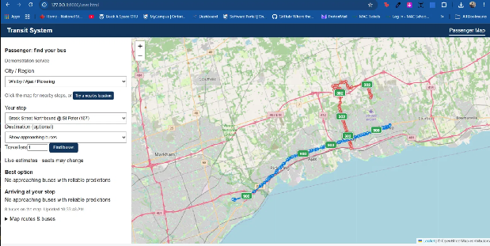
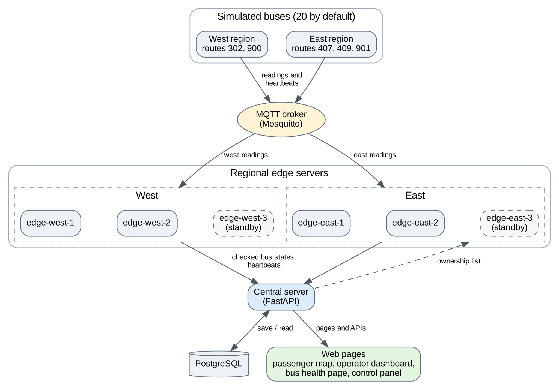
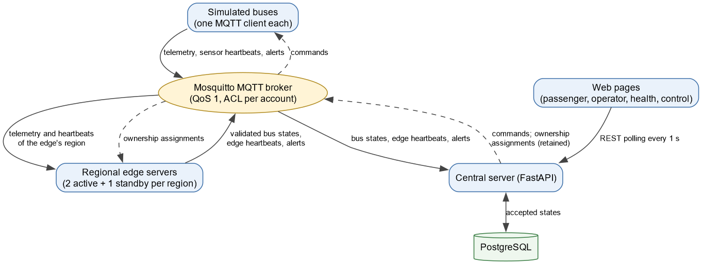
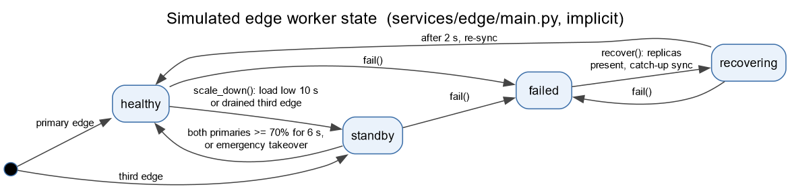
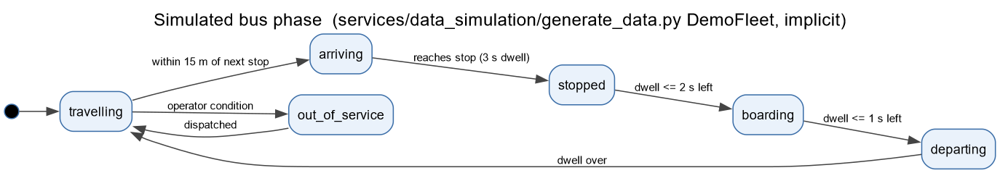

# A Fault-Tolerant, Edge-Assisted Public Transit System

SOFE 4790U Distributed Systems, Group 14, Final Project Report

| Team member | Student ID |
| :---- | :---- |
| Zachary Matasic | 100918415 |
| Lok Yung (Carson) Chan | 100926449 |
| Danial Shaikh | 100698628 |
| Ali Hakkani | 100867456 |
| Julian Olano Medina | 100855732 |

# Abstract

Riders and operators of a public transit network both depend on live information they can trust: where a bus is, how full it is, and when it will arrive. This report describes a simulated public transit system for Durham Region that applies distributed systems principles to keep that information accurate and available.

The system is organized into three tiers. Simulated buses publish their location, speed and passenger counts over MQTT. Two regional edge servers per region then validate and process that data, and a central server combines the results into a single view of the network. A passenger map, an operator dashboard, a bus health page and a scenario control panel are built on top of this architecture.

Message ordering does not rely on each machine's clock. Instead, per-bus sequence numbers and Lamport clocks determine which update is the newest. Availability is maintained by the central server, which monitors heartbeats from every edge server and transfers a failed server's buses to a healthy one. The central server also tracks the occupancy of each route, and can dispatch additional buses when a route remains crowded.

Testing produced three main findings:

1. No message was ever applied out of order, even during network outages.
2. The system continued to process every reading after an edge server failed.
3. Enabling demand scheduling raised the number of boarded passengers from 25 to 89 in a matched four-minute run.

# Introduction

Reliable public transit depends on timely and accurate information. Riders need to know where their bus is and how crowded it is in order to plan a trip. Operators need the same information to respond to traffic delays, sudden demand surges, and vehicle or sensor faults, for example by dispatching additional buses.

Current tracking approaches fall short for two reasons. The first is unreliable delivery. Vehicle telemetry travels over unstable connections, so updates can arrive late, arrive twice, or be lost entirely. If updates are applied in the order they arrive, or if every vehicle's clock is trusted as though clock drift did not exist, outdated information can overwrite newer positions. The second is a single point of failure. When the telemetry of every bus is routed into one central server, that server becomes a bottleneck, and its failure leaves the entire network without information.

Addressing these limits requires a distributed architecture that separates vehicles from back-end services, validates telemetry close to where it is produced, orders updates without relying on physical clocks, and continues operating when individual servers or sensors fail.

The goal of this project was to design and simulate a transit system that remains accurate and operational when parts of it fail. The project proposal set out four objectives:

1. **Real-time bus tracking.** Live updates from every bus reach passengers and operators through publish-subscribe messaging.
2. **Demand-responsive scheduling.** Crowded routes receive more buses, and quiet routes receive fewer.
3. **Fault tolerance and load balancing.** The failure of one regional server does not cut a region off.
4. **Correct event ordering.** A delayed or repeated message can never replace newer information.

The project draws directly on course material. Communication uses publish-subscribe messaging through an MQTT broker, while events are ordered with logical clocks and sequence numbers under explicit assumptions about physical clock synchronization. Failures are detected through heartbeats and tolerated through replication and ownership transfer, and work is balanced between servers. The project also confronts the classic problems of message passing: messages that arrive late, arrive twice or never arrive, and servers that stop responding.

The remainder of this report is split into four sections:

1. Related Work
2. Main Body of Work
3. Evaluation
4. Conclusion

- Related Work reviews existing transit information systems and the techniques this project borrowed from them.
- "Main Body of Work" explains the design and implementation of each component of the system.
- Evaluation presents the results of testing ordering, fault tolerance, scheduling and security.
- The Conclusion summarizes the project's contributions, and is followed by the design diagrams and directions for future work.

# Related Work

Real-time transit information is already a common service. As such, the team examined how existing systems handle it before designing this one.

**GTFS Realtime.** Most transit agencies share live data using GTFS Realtime, a format created by Google \[1\]. A GTFS Realtime feed publishes vehicle positions, trip updates and service alerts that applications such as Google Maps can read. Durham Region Transit, whose routes and stops were used in this simulation, publishes its schedule data in the GTFS format \[9\]. However, GTFS Realtime is a data format, not a complete system. It describes what a vehicle position looks like, but it does not specify how an agency should validate the data, order late updates, or keep its servers running when one fails. Each agency's back end must solve those problems on its own.

**OneBusAway.** OneBusAway is an open source transit information system that originated at the University of Washington \[2\]. It takes in an agency's schedule and real-time data and provides riders with arrival times through a website, mobile applications and an API. Like most rider applications, it relies on a single central back end that receives every vehicle update.

**The Transit app.** Transit is a popular commercial application that also displays live bus locations. When an agency's own real-time data is missing or of poor quality, Transit can use location data shared by riders on the bus to improve its predictions \[3\]. This demonstrates that real-time data is often incomplete, and that a sound system must handle missing or uncertain information rather than hide it.

**Borrowed techniques.** Four established techniques shaped this design. Edge computing \[4\] processes data close to where it is created instead of sending it to one central location, which reduces the load on the central server and allows each region to operate independently. Messaging uses MQTT \[5\], a lightweight publish-subscribe protocol and OASIS standard, through the open source Mosquitto broker \[6\]. Events are ordered with Lamport's logical clocks \[7\], and clock offsets between machines are estimated with Cristian's algorithm \[8\].

Table 1 compares this system with the existing tools. Existing rider applications focus mainly on presenting data, whereas this project focuses on how the data is moved, validated, ordered and kept available behind the scenes. The caveat is scale: this system simulates one region with simulated buses, while the existing tools run on real fleets and serve real riders.

| Feature | GTFS Realtime feeds | Rider apps (OneBusAway, Transit) | Our system |
| :---- | :---- | :---- | :---- |
| Live bus locations | Yes, as a shared data format | Yes | Yes, from simulated buses |
| Where the data is processed | Each agency's own servers | One central back end | Regional edge servers, then a central server |
| Handling late or repeated updates | Timestamps in each message | Not described publicly | Per-bus sequence numbers and Lamport clocks |
| Server failure handling | Left to each agency | Not described publicly | Heartbeats and automatic takeover by another edge server |
| Schedule changes based on demand | Not covered | Not covered | Extra buses sent to routes that stay crowded |
| Scale | Real agencies around the world | Real riders in many cities | One simulated region, up to 50 buses |

*Table 1: Comparison of our system with existing transit information tools*

# Main Body of Work

## System Overview

The system consists of five components, each with a distinct responsibility. The buses produce data, the MQTT broker moves it, the edge servers validate and process it, the central server stores it and makes network-wide decisions, and the web pages present it to passengers and operators.

The components communicate only through agreed message formats, MQTT topics and REST endpoints. Because of this, each component can be developed, tested and replaced independently. Figure 9 shows the full layout, and Figure 10 shows how data moves between the components.

**Map data.** The simulation uses real Durham Region Transit data: five routes, 373 stops, and both travel directions for each route. These routes are split into two regions. The West region (Whitby, Ajax and Pickering) contains routes 302 and 900, while the East region (Oshawa) contains routes 407, 409 and 901. By default, 20 buses are in service, four per route, and each region has two active edge servers plus a standby third.

**Run modes.** The system can run in one of two modes. In live mode, separate bus programs publish real MQTT messages to separate edge server processes, and the central server saves the results to a PostgreSQL database. In controlled demonstration mode, the central server runs the same validation and processing code within a single process driven by a simulation clock.

The demonstration mode was used for repeatable tests and for triggering failures and recoveries on demand. Its advantage is that components can be broken deliberately without stopping real processes.

## Bus Simulation

Since real buses were not available, a simulator was built to make each bus behave like a real vehicle. Each bus follows the ordered stops of its route, travelling at about 30 km/h in normal traffic and slowing to 9 km/h in heavy traffic. It waits three seconds at each stop while passengers board and alight. Each bus has 50 seats, and its passenger count depends on the demand setting: peak demand fills buses, while off-peak demand leaves them mostly empty.

**Readings.** Every second, each bus sends a reading containing the following fields:

- bus ID, city, region and route;
- GPS position, speed and direction;
- number of passengers and seats;
- current and next stop;
- the time the reading was made;
- a sequence number and a Lamport clock value;
- bus status and sensor status.

The sequence number increases by one with every reading. This is what later allows the edge and central servers to identify old or repeated messages.

**Phases and sensors.** Buses move through realistic phases around each stop: travelling, arriving, stopped, boarding and departing (Figure 21). They can also be taken out of service. Separately from their readings, buses send heartbeats every two seconds for four sensors: GPS, speed, stop status and passenger count. When a sensor fails, the bus reports the failure rather than inventing a value. For example, if the passenger counter breaks, the bus continues to send its location but marks its occupancy as faulty.

**Repeatability.** The simulator supports fleets of 5, 10, 20, 25 and 50 buses, and new buses can be added through a configuration object. Operators can pause and resume buses, change demand and traffic, and enable sensor failures. Every scenario uses a fixed random seed, so running the same scenario twice produces the same results. This ensured that tests and comparisons were fair.

## MQTT Messaging and Event Ordering

**Topics.** All communication between buses, edge servers and the central server passes through a Mosquitto MQTT broker. Because MQTT is publish-subscribe, a bus does not need to know which server will read its data. It publishes to a topic for its region and bus, such as `transit/buses/west/bus-302-1/telemetry`, and the edge servers for that region subscribe to it. Edge servers in turn publish validated bus states on a separate topic for the central server. Additional topics carry heartbeats, alerts, commands and ownership assignments. As such, new buses or servers can be added without changing the others.

**Ordering.** Every message is sent with QoS 1, which guarantees at-least-once delivery. A message is therefore not silently dropped while the connection is up, but it can arrive late or more than once. Rather than trusting arrival order, every reading carries three pieces of ordering information:

1. **Sequence number.** This decides whether a reading is accepted. The edge and central servers accept a reading only if its sequence number is higher than the last one they accepted for that bus.
2. **Lamport clock.** This orders events across processes without trusting their wall clocks. Every process increments its clock when it sends a message. On receiving a message, it sets its clock to the larger of its own value and the received value, plus one.
3. **Timestamp.** This is the real time the reading was made. It is used only for display, and never to accept or reject a message.

**Lost connections.** If a bus loses its connection, it continues generating readings and holds up to 1,000 of them in memory. It then resends them in their original order once it reconnects.

The caveat to this approach surfaced during testing, where a real ordering bug was found. The MQTT library reported the bus as reconnected before it had finished resending old messages, so a brand new reading could overtake older ones and cause them to be rejected as stale. The fix was to hold new readings back until every older reading has been acknowledged.

**Publisher state machine.** To make this rule easy to verify, the publisher's connection is modelled as an explicit state machine with five states: connecting, online, resending, offline and closed (Figure 18). A reading goes straight to the broker only in the online state. In every other state it waits in a local backlog, which a background thread sends in order once the connection is back online and every older reading has been acknowledged. The allowed transitions are defined in a single table in the code, and a unit test drives the publisher through every state.

**Physical clocks.** The design assumes that every machine is kept within two seconds of real time, for example with NTP. Because ordering never depends on the timestamp, an incorrect clock only makes the displayed time misleading; it does not corrupt the data. This was tested with simulated clocks that were several seconds off, drifting, or even years wrong, and ordering remained correct in every case. Cristian's algorithm was also implemented to estimate the offset between two machines, and vector clocks were used in the analysis to distinguish events that happened one after another from events that were concurrent.

**Alerts and commands.** Alerts and commands also travel over MQTT. Buses send alerts when a sensor fails or recovers, and edge servers send an alert when their queue is full. In the other direction, operators can send commands to a single bus or a whole region, for example to pause buses or change traffic conditions.

Each command carries a unique ID, so it is applied only once even if it is delivered twice. A bus is always in one of three modes: running, paused or stopped (Figure 19). Stopped is final, so a late resume command cannot restart a bus that is shutting down.

**Broker security.** On the secured version of the broker, every service has its own account and may only publish and subscribe to its own topics. Consequently, a bus cannot impersonate another bus or issue a command.

## Regional Edge Servers

Each region has two active edge servers that share the buses in that region, along with a standby third server that can be started when both are busy. An edge server is the first point at which bus data is validated.

**Checking a reading.** When a reading arrives, the edge server:

1. checks the message signature to confirm that it came from that bus;
2. converts it into the shared format if needed (the standard JSON format, a different vendor JSON format, or CSV);
3. validates it, rejecting cases such as impossible GPS positions, negative speeds, more passengers than seats, unknown buses, or a bus claiming to be in the wrong region;
4. checks that it is actually the owner of that bus.

**Processing.** Accepted readings enter a queue that holds at most 50 waiting messages, so a flood of data cannot exhaust the server's memory. The edge server then processes each reading. It calculates how full the bus is and assigns a crowding level of low, medium or high, with cut-offs at 50% and 80%. It also determines how far along the route the bus has travelled, and stores the latest state of every bus in a cache.

Old, duplicate or conflicting readings are rejected at this stage, so they never overwrite newer data. Only new, accepted states are forwarded to the central server.

**Health.** Edge servers track the heartbeats of every sensor on their buses. They also send their own heartbeat to the central server every two seconds, together with how full their queue is. This allows the central server to notice when an edge server stops responding. Figure 16 shows how a heartbeat source moves between the unknown, healthy, recovering and unavailable states.

**Failover.** When an edge server fails, its buses need a new owner. In the controlled demonstration, every accepted bus state is copied to the other edge servers, so a healthy server already holds the latest data when it takes over. Each bus also carries an ownership version number that increases every time its owner changes. Because of this, an old owner that comes back cannot overwrite data from the new owner. A recovering server first catches up on the latest state, and only receives buses back after that. If both servers in a region fail, a healthy server in the other region can take over that region's buses.

Figure 17 shows the edge server lifecycle, and Figure 11 shows a failure and recovery as a sequence of messages.

**Load balancing.** Under normal conditions, buses are split evenly between the two servers in a region. If both servers' queues remain at least 70% full for six seconds, the standby third server synchronizes and takes on part of the work. When the load drops again, it hands the buses back and returns to standby.

## Central Server and Scheduling

The central server sits at the top of the system's hierarchy. It stores and reads data in the PostgreSQL database, monitors the health of the other components, checks every bus state before ingesting it, and provides server-side services such as arrival-time estimates and trip planning.

In this role it acts both as the coordinator of the components and as the gateway between the edge servers and the users. Its API is built with FastAPI \[12\]. Some services are public, such as arrival estimates for the remaining stops of a bus, while others are restricted to operators, such as edge server health and simulation control.

### Arrival times

Arrival times are computed by following the route, rather than by measuring straight-line distance to the stop:

1. Starting from the bus's current stop, the server takes the great-circle (haversine) distance from the bus to the next stop.
2. It adds the distance of every route segment up to the target stop.
3. It divides the total by the bus's reported speed, or by a cruising speed when the bus is stopped.
4. It adds a three-second dwell time for every intermediate stop.

When the stop is behind the bus, the stop is not on its route, or the speed is missing or invalid, no estimate is returned rather than a guessed one.

The server also measures its own accuracy. It records each next-stop prediction, and when the bus is later observed stopped at that stop, it stores the difference between the predicted and actual arrival times. The operator pages display the mean absolute error of the last 100 predictions.

### Ingestion checks

Each bus state reaches the central server through an edge server, but not every message should be stored. Three situations can make a message wrong. A faulty sensor can report an illogical value, such as a wrong region or a stop that jumps backwards. A message can arrive late. Finally, after a server recovers, two edge servers can briefly both claim the same bus.

Before storing anything, the server validates the message against the `BusStateUpdate` schema and then checks five conditions in order:

1. The region in the message matches its topic.
2. The sequence number is newer than the last one stored for that bus.
3. The reported region matches the bus's assigned region.
4. The sending edge server is the bus's current owner.
5. The next stop is actually ahead of the bus on its route.

The ownership check is particularly important after a failover. Without it, a recovered home server could send states for a bus it no longer owns, before it has read the new ownership list.

### Edge monitoring

All edge servers report their status through heartbeats. The central server accepts a heartbeat only if it comes from a known edge server on the expected topic, its bus list contains no duplicates and only valid buses, and each bus reports its full set of sensors.

Each heartbeat carries a session ID and a sequence number. As such, a delayed heartbeat from before a restart cannot make a dead server appear alive. The timeout is 10 seconds and is measured with a monotonic clock, so changes to the wall clock do not affect failure detection.

### Failover

An edge server is marked unavailable once no heartbeat has arrived for 10 seconds. Because the failover round runs every second, the central server notices this within at most 11 seconds.

Once a failure is confirmed, each of the failed server's buses is moved to the least-loaded healthy edge server in the same region, with ties broken by edge ID. Only a confirmed failure moves buses. An edge whose status is still unknown or recovering keeps its buses, so a staggered start-up or a brief recovery does not cause buses to bounce between servers.

Every change increases the region's ownership epoch. The central server publishes the new assignment as a retained MQTT message, so an edge that restarts receives the current owner list immediately. The central server also republishes every region's assignment whenever its own MQTT connection is restored. When the home edge server becomes healthy again, its buses are returned to it in the next round.

### Trip planning

Passengers can search for a trip between two stops. The central server looks for direct buses and for trips with one transfer, and estimates the waiting time, riding time and total time of each. It then ranks the options by total time, bus occupancy and number of transfers, with each transfer counted as an extra five minutes.

Buses without enough free seats for the group are still listed, but are never recommended. Each recommendation comes with a short explanation, such as how many minutes the trip takes and how many seats are free.

### Demand scheduling

The central server checks the occupancy of each route every two seconds. If three consecutive fresh samples show a route at least 80% full, it recommends adding service. Conversely, if three consecutive samples show it at most 20% full, it recommends reducing frequency.

Two safeguards keep these decisions stable. After a change, the server waits 30 seconds before making another decision for that route, so one unusual reading cannot trigger repeated changes. In addition, a recommendation that waits more than 30 seconds for approval is replaced with a fresh one, so it never goes stale.

An operator can approve each decision, or switch on automatic mode. When a decision is approved in the demonstration, a reserve bus is dispatched on that route, and the central server confirms the change once it sees that bus's readings arrive. Figure 20 shows this decision cycle.

### Access control

Passenger pages and passenger data are public, whereas every management action, such as failing a server or dispatching a bus, requires an operator login. These checks are enforced on the server rather than only in the web page, and requests originating from other websites are rejected. The passenger data also hides internal details, such as which edge server owns a bus, and no personal information about passengers is stored.

## User Interfaces

**Pages.** The user interface is a web application written in plain HTML, CSS and JavaScript. It uses Leaflet \[10\] and OpenStreetMap \[11\] for the map, and the pages are served by the central server itself. Passengers and operators have separate pages, so passengers see only what they need and cannot reach any management controls. Every page requests new data from the central server every second, so bus movements and status changes appear without reloading.

**Development.** The first version of the pages was built using mock data shaped like the central server's responses. This allowed work on the interface to begin before the back end was ready; once the real APIs were complete, only the data source had to be switched. Operators can still choose between the live MQTT data and the controlled demonstration from a menu on their pages.

**Untrusted text.** Text that originates from bus telemetry, such as the bus status, is HTML-escaped before it is displayed. Consequently, a compromised bus cannot inject a script into a passenger's or operator's browser.

### Passenger Map

The passenger map is the page riders use. It shows the routes, stops and buses for the selected region, with each bus labelled by its route and coloured by how crowded it is.

**Planning a trip.** A passenger selects a region, chooses their stop and an optional destination, and enters how many people are travelling. The page then shows the best option, including when the bus arrives, how long the trip takes, how full the bus is and how many seats are free, followed by a list of buses arriving at that stop.

**Clicking the map.** Passengers can also click anywhere on the map. The system then checks the five closest stops to find a bus the passenger can still walk to in time.

**Honest data.** Care was taken never to present information as live when it is not. A bus that has not reported recently, or whose position is missing or invalid, is not shown as a live position. If no prediction can be made, the page says so, for example "No approaching buses with reliable predictions", rather than inventing a time.

*Figure 1: Passenger map for the west region, showing routes 302 and 900 and the live buses*

<!-- Screenshot needed: trip search result -->
*Figure 2: Trip search showing the recommended bus, arrival time, trip time and free seats*

### Operator Login

Operator pages are protected by a login page. Anyone who opens an operator page without signing in is redirected to the login page first. After signing in, operators can move between the dashboard, the bus health page and the control panel, and sign out when they are finished.

<!-- Screenshot needed: login page -->
*Figure 3: Operator login page*

### Operator Dashboard

The operator dashboard provides an overview of the whole network. At the top, a summary shows how many buses are live, how many are crowded, how many edge servers are healthy and how many alerts are active. Below this are the current alerts and a table of every bus with its route, status, speed, passengers, crowding level, last update and sensor health. A further table lists each route with its average occupancy. Finally, the dashboard shows every edge server's status, queue and assigned buses, along with recent events such as failures, recoveries and buses being moved between servers.

Problems are colour-coded, so a crowded route or a failed server stands out immediately.

<!-- Screenshot needed: dashboard -->
*Figure 4: Operator dashboard with the network summary, alerts and bus table*

### Bus Health Page

The bus health page is a read-only page for examining one bus, route or sensor in detail. The operator selects a region, route, bus and sensor, and the page then shows whether that sensor is healthy, faulty or unavailable, how old the last valid reading is, which edge server owns the bus, and the queue load on each edge server.

The page keeps an unknown state separate from a confirmed fault. Because of this, a server that has stopped reporting is not mistaken for a broken sensor.

<!-- Screenshot needed: health page -->
*Figure 5: Bus health page showing edge server queues and sensor status*

### Control Panel

The control panel is where operators change the simulation.

**One-click scenarios.** The top of the page has a button for each feature to be demonstrated:

- normal service and 50 active buses;
- load balancing and edge takeover;
- sensor fault, traffic delay and peak demand;
- the scheduling loop;
- a central server outage and recovery;
- an access security check.

**Manual settings.** Below the scenarios, operators can set the demand for each route, change the fleet size, register and dispatch buses, and apply conditions to a single bus. They can also fail or recover edge servers, send bursts of requests to test load, and change the simulation speed.

If a command is invalid, the page shows a clear error message from the server rather than failing silently.

<!-- Screenshot needed: control panel -->
*Figure 6: Control panel with the one-click demonstration scenarios*

# Evaluation

The evaluation examines four properties: correct ordering and delivery of messages, behaviour under failure and load, the effect of demand scheduling, and security. Each component was first tested on its own through its agreed contract (message schemas, MQTT topics or REST API), and the whole system was then tested together.

## Testing

The full automated suite contains 506 tests. In the latest run, 487 passed and the remaining 19 were skipped because they require separate live services, such as a dedicated broker or database.

**Live broker tests.** The messaging live tests were run separately against three real Mosquitto brokers: a plain broker, one that the test stops and restarts, and the secured broker with passwords and access control lists. All 168 messaging and broker-authentication tests passed, including the 15 that require a live broker.

**Other testing.** The database tests were run against PostgreSQL with four separate edge server processes. The web pages were also tested in a browser, covering trip searches, operator login, the dashboard, the health page and the control panel scenarios.

## Message Delivery and Ordering Results

To measure messaging, simulated buses were run as separate MQTT clients. Each bus sent five readings per second for 15 seconds, and the time each message took to arrive was recorded. Three network conditions were tested:

1. a normal network;
2. a network where every packet was held for 200 milliseconds;
3. a three-second outage in which every bus lost its connection.

Table 2 shows a selection of the results.

| Scenario | Buses | Sent | Received | Lost | Out of order | Median delay | Worst delay |
| :---- | :---- | :---- | :---- | :---- | :---- | :---- | :---- |
| Normal | 10 | 750 | 750 | 0 | 0 | 1.3 ms | 4.4 ms |
| 200 ms delay | 10 | 750 | 750 | 0 | 0 | 2.3 ms | 233.9 ms |
| 3 s outage | 10 | 750 | 750 | 0 | 0 | 2.3 ms | 7.0 s |
| Normal | 50 | 3,750 | 3,750 | 0 | 0 | 2.0 ms | 25.3 ms |
| 3 s outage, default broker queue | 50 | 3,750 | 3,610 | 140 | 0 | 2.7 ms | 7.4 s |
| 3 s outage, larger broker queue | 50 | 3,750 | 3,750 (+1 duplicate) | 0 | 0 | 2.8 ms | 7.4 s |

*Table 2: Message delivery results for different numbers of buses and network conditions*

**Ordering.** In every run, including the outages, no message arrived out of order and no Lamport clock values were incorrect.

**Delay.** On a normal network, messages arrived in about 2 milliseconds. During an outage, the worst delay was about 7 seconds, which consists of the 3-second cut plus the time the MQTT library waits before reconnecting.

**The one loss.** A single loss occurred, at 50 buses with an outage. All 50 buses resent about 1,400 saved messages at once, which exceeded the broker's default limit of 1,000 queued messages for one subscriber, so 140 messages were dropped. The tracking recorded exactly which messages were lost, and raising the broker's limit to 10,000 eliminated the loss.

**Throughput.** A single Python subscriber can handle about 1,900 messages per second. This is sufficient for the current setup, since each region has its own subscribers.

## Fault Tolerance and Scalability

To test the edge servers, 20 rounds were run in which every bus sent one reading per round, and edge-west-1 was made to fail halfway through. This was repeated with 5, 10, 25 and 50 buses. Table 3 shows the results. In every case, all accepted readings were processed, and none were rejected or left waiting after the failure.

| Buses | Readings processed | Delay before failure (ms) | Delay after failure (ms) | Time to decide takeover (ms) | Buses on the surviving west server |
| :---- | :---- | :---- | :---- | :---- | :---- |
| 5 | 100 | 6 | 7 | 0.44 | 2 |
| 10 | 200 | 9 | 11 | 1.17 | 4 |
| 25 | 500 | 18.8 | 23.8 | 4.20 | 10 |
| 50 | 1,000 | 35 | 45 | 10.32 | 20 |

*Table 3: Edge server results with edge-west-1 failing halfway through each run*

The delay grows with the number of buses and rises after a failure, because one server is then doing the work of two. Even so, the system continues to process everything. Deciding which server takes over took between half a millisecond and about ten milliseconds. These delays come from a simulation with a fixed 5 ms processing time per reading, not from a real network. As such, they show how the design behaves rather than how fast real hardware would be.

The full failure and recovery cycle was also verified in the browser:

1. After an edge server was failed from the control panel, the dashboard showed it as failed, raised an alert, and listed the buses that moved to the other server.
2. After it was recovered, the server showed as recovering and then as healthy again.

<!-- Screenshot needed: dashboard after takeover -->
*Figure 7: Operator dashboard after the edge takeover scenario*

## Demand Scheduling Results

To test scheduling, matched four-minute simulations of route 302 were run. Each began with one active bus, the same reserve buses and the same passenger demand; the only difference was whether scheduling was enabled.

In normal traffic, enabling scheduling increased the number of passengers who boarded from 25 to 89. It also reduced the total waiting time slightly, from 817,328 to 814,071 passenger-seconds, and lowered average occupancy from 99.6% to 97.8%. In heavy traffic, however, both runs boarded only 5 passengers in the same time, even though 8 extra buses were dispatched.

To summarize, extra buses help, but in heavy traffic they take longer than the short test window to reach the waiting passengers.

<!-- Screenshot needed: scheduling decision -->
*Figure 8: Scheduling decision for a crowded route during the peak demand scenario*

## Security and Privacy

Security was addressed at every layer. Publishers can sign their messages, and edge servers reject unsigned, tampered or replayed messages. On the secured broker, anonymous logins and incorrect passwords are refused, and each bus can only publish its own data. On the web, passengers can view public data without logging in, while every management action requires an operator login that is checked on the server, and text from bus telemetry is escaped before it is displayed. Regarding privacy, no passenger names or personal data are stored.

Some limits remain. The demo operator account uses a simple shared password, with a built-in default when none is configured. There is no HTTPS. In addition, the container setup sends broker passwords over plain TCP inside the private container network.

## Usability and Transparency

**Usability.** The passenger page was kept deliberately simple: a passenger picks a stop and an optional destination, and receives one recommended bus with a plain explanation. Uncertain information is clearly labelled rather than hidden, so passengers are never shown an invented arrival time or a bus that is not truly live. For operators, the dashboard, health page and control panel all read the same back-end data. Consequently, a change made in the control panel appears on the other pages within a few seconds.

**Transparency.** The system is also transparent in the distributed systems sense. Passengers do not need to know which edge server handles their bus, or that a server failed and another took over.

## Code Quality and Design Review

To confirm that the design described here matches what was built, class diagrams were generated directly from the code (Figures 12 to 15). The code was also reviewed for lifecycles that move through a fixed set of states (Figures 16 to 21).

**Explicit and implicit state machines.** The messaging layer models its two lifecycles as explicit state machines, each consisting of an enumeration of states and a table of allowed transitions. These are the publisher's connection and a bus's simulation mode. Replacing four interacting flags with a single state made the reconnect ordering rule easy to read and test. In the other components, the states are still implicit: status strings, booleans, counters and timestamps that are changed in several places.

**Problems found and fixed.** Drawing the machines exposed three problems:

1. **Stuck scheduling decision.** A recommendation that stayed pending for more than 30 seconds could never be approved, because it was never refreshed while demand stayed high.
2. **Blocking work on the event loop.** The failover round and the simulation clock ran blocking work directly on the web server's event loop, so a long simulation step could pause every request, including failover. Both now run in a worker thread.
3. **Unescaped bus status.** The bus status text was not escaped on the web pages.

After these changes, the full test suite and the live broker tests passed again with the same results.

## Limitations

Because this system is a classroom simulation, it has several limits. The takeover and replication in the controlled demonstration are run by a single in-memory coordinator. This is not a true distributed agreement protocol, and its state is lost if the central process restarts.

The scope is also narrow: only one city with two regions was modelled, and the buses are simulated rather than real. Distances to nearby stops are straight-line estimates. The edge server lifecycle remains implicit, and a failed or recovering edge server can be moved straight to standby, which skips the recovery checks. Finally, the demo login and the lack of HTTPS mean the system is not ready for real public use.

# Conclusion

This project produced a simulated public transit system for Durham Region that keeps bus information accurate and available by applying distributed systems principles. Buses publish their data over MQTT, regional edge servers validate and process it, and a central server combines it, estimates arrivals, recommends trips and adjusts service based on demand. Passengers and operators interact with the system through a passenger map, an operator dashboard, a bus health page and a control panel.

The project's main contributions are:

1. a three-tier design that spreads work across regions instead of sending everything to one server;
2. an ordering approach using sequence numbers and Lamport clocks, enforced by an explicit publisher state machine, that kept every message in order during testing;
3. automatic failure detection and takeover between edge servers;
4. demand-based scheduling that dispatches extra buses to crowded routes;
5. an interface that clearly shows when information is uncertain.

The results confirmed each of the project's core objectives. Messages were never applied out of order, even during outages. The system continued to process every reading when an edge server failed. Finally, scheduling more than tripled the number of passengers who boarded in the normal traffic test. Taken together, these results show that reliable transit information does not require a single, perfect server; it requires a design that expects messages to be late and servers to fail, and remains correct when they do.

The team divided the work by component, as shown in Table 4.

| Team member | Main responsibility | Share of work |
| :---- | :---- | :---- |
| Zachary Matasic | Bus simulation: routes, movement, passenger demand, sensor faults and repeatable scenarios | TBD |
| Julian Olano Medina | MQTT messaging: broker setup, topics, Lamport clocks, reconnection handling, alerts, commands, broker security, and the code review behind Figures 12 to 21 | TBD |
| Ali Hakkani | Regional edge servers: validation, processing, heartbeats, failover, load balancing and scaling | TBD |
| Lok Yung (Carson) Chan | Central server: database, APIs, ingestion checks, edge monitoring, arrival times, trip planning and scheduling | TBD |
| Danial Shaikh | User interfaces: passenger map, operator dashboard, bus health page, control panel and report diagrams | TBD |

*Table 4: Contribution matrix*

# Schematic

Figure 9 shows the overall layout of the system. Buses in each region publish their readings to the MQTT broker. The two edge servers for that region read those readings, validate and process them, and publish the accepted bus states back through the broker to the central server. The central server stores these states in PostgreSQL and monitors the edge servers through their heartbeats. In the other direction, it sends ownership updates to the edge servers and commands to the buses. It also serves the web pages and APIs used by passengers and operators.

*Figure 9: System schematic*

# Design Diagrams

## Data Flow and Failover

Figure 10 shows how data moves through the system: from the simulated buses, through the MQTT broker and the regional edge servers, to the central server and finally the web pages. Solid arrows carry data upwards, while dashed arrows carry control messages back down. The pages request new data from the central server every second over REST.

*Figure 10: Data flow from the simulated buses to the web interfaces*

Figure 11 shows the sequence of events when an edge server fails and later recovers.

*Figure 11: Edge server failure, takeover and recovery*

## Class Diagrams

The class diagrams were generated directly from the code with pyreverse, the UML tool included in pylint \[13\], and rendered with Graphviz. They show the classes and public members of each tier. Because the components mostly communicate through functions, MQTT topics and JSON schemas rather than object references, few associations appear between classes. This is consistent with the loose coupling described in the System Overview.

*Figure 12: Classes of the messaging layer (services/messaging)*

*Figure 13: Classes of the regional edge servers (services/edge)*

*Figure 14: Classes of the central server (services/central)*

*Figure 15: Shared schemas and the bus simulator (shared/schema, services/data_simulation)*

## State Machines

Figures 18 and 19 are explicit in the code. The remaining figures are implicit, and are drawn from how the code behaves.

*Figure 16: Liveness of an edge server or bus sensor, derived from heartbeats (10 s timeout, 4 s recovery window)*

*Figure 17: Lifecycle of an edge server in the controlled demonstration, including standby, takeover and recovery*

*Figure 18: Connection states of the bus publisher, which keep readings in order across a reconnect*

*Figure 19: Simulation mode of a bus, changed by MQTT commands*

*Figure 20: Demand scheduling decision for one route*

*Figure 21: Movement phase of a simulated bus around a stop*

# Future Work

Several directions would extend this system beyond a classroom simulation.

The most immediate is real data. Connecting to Durham Region Transit's real-time feed would allow the system to run on real bus positions instead of simulated ones.

The second concerns coordination. Replacing the single in-memory coordinator with a proper replicated agreement protocol would allow ownership and bus state to survive the loss of any one server, including the central one. Alongside this, the remaining implicit state machines should be made explicit, beginning with the edge server lifecycle (Figure 17). A transition table like the one in the publisher would reject the failed-to-standby path that currently skips the recovery checks.

Safety and usability also require further work. This includes HTTPS and TLS for the broker, real operator accounts with distinct roles instead of one demo login, a mobile version of the passenger page, and walking directions that follow real streets.

Finally, the scheduler currently reacts only to crowding that is already occurring. If past data were used to predict busy periods, buses could be added before routes become crowded. Extending the system to more than one city would then test whether the regional design scales as intended.

# References

\[1\] Google, "GTFS Realtime Overview," Google for Developers. \[Online\]. Available: https://developers.google.com/transit/gtfs-realtime

\[2\] OneBusAway, "The OneBusAway Application Suite," GitHub. \[Online\]. Available: https://github.com/OneBusAway/onebusaway-application-modules

\[3\] K. Korosec, "Transit app begins crowdsourcing data to provide accurate, real-time info," TechCrunch, Dec. 20, 2016. \[Online\]. Available: https://techcrunch.com/2016/12/20/transit-app-begins-crowdsourcing-data-to-provide-accurate-real-time-info/

\[4\] W. Shi, J. Cao, Q. Zhang, Y. Li and L. Xu, "Edge Computing: Vision and Challenges," IEEE Internet of Things Journal, vol. 3, no. 5, pp. 637-646, 2016.

\[5\] OASIS, "MQTT Version 5.0," OASIS Standard, 2019. \[Online\]. Available: https://docs.oasis-open.org/mqtt/mqtt/v5.0/mqtt-v5.0.html

\[6\] R. A. Light, "Mosquitto: server and client implementation of the MQTT protocol," Journal of Open Source Software, vol. 2, no. 13, p. 265, 2017.

\[7\] L. Lamport, "Time, Clocks, and the Ordering of Events in a Distributed System," Communications of the ACM, vol. 21, no. 7, pp. 558-565, 1978.

\[8\] F. Cristian, "Probabilistic clock synchronization," Distributed Computing, vol. 3, no. 3, pp. 146-158, 1989.

\[9\] Region of Durham, "Durham Region Transit GTFS data." \[Online\]. Available: https://maps.durham.ca/OpenDataGTFS/GTFS_Durham_TXT.zip

\[10\] Leaflet, "Leaflet: an open-source JavaScript library for interactive maps." \[Online\]. Available: https://leafletjs.com/

\[11\] OpenStreetMap contributors, "OpenStreetMap." \[Online\]. Available: https://www.openstreetmap.org/

\[12\] FastAPI, "FastAPI." \[Online\]. Available: https://fastapi.tiangolo.com/

\[13\] PyCQA, "Pyreverse: UML diagram generator," pylint documentation. \[Online\]. Available: https://pylint.readthedocs.io/en/latest/additional_tools/pyreverse/index.html
