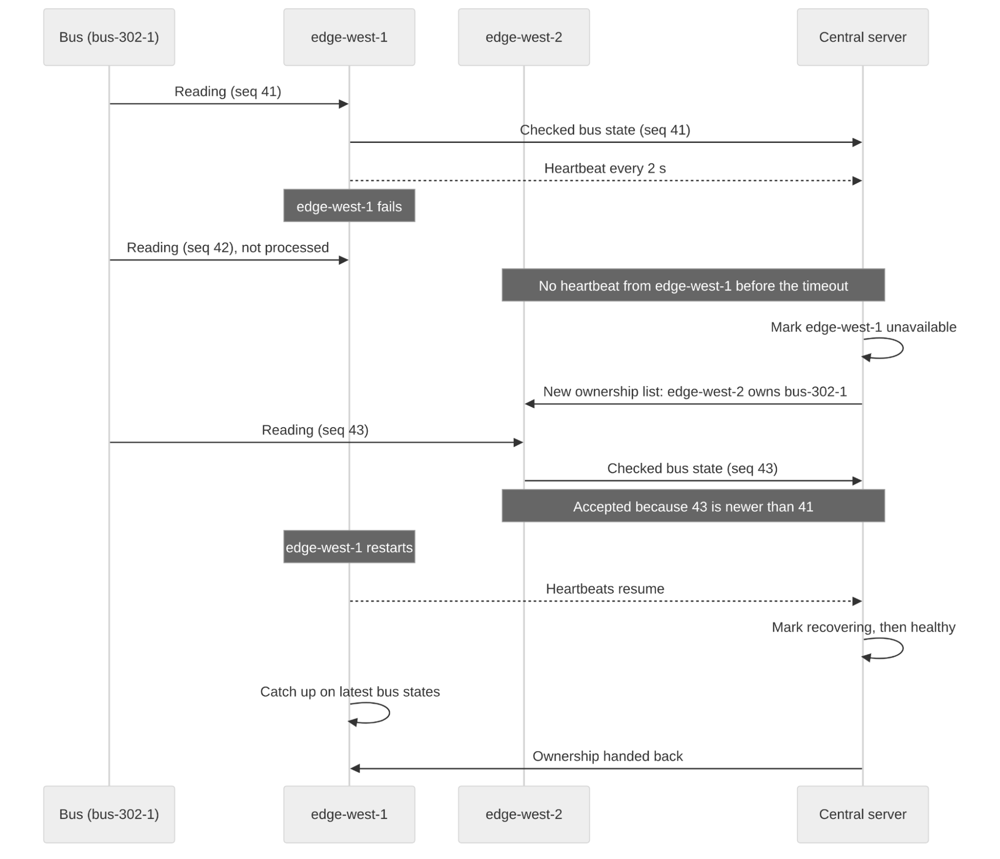
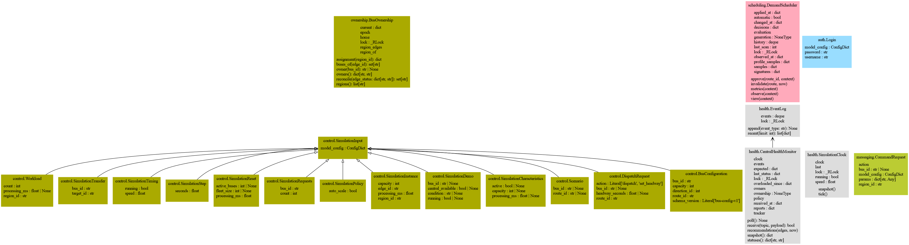

Faculty of Engineering & Applied Science

Distributed Systems, SOFE 4790U

November 25th, 2026

# A Fault-Tolerant, Edge-Assisted Public Transit System

Final Project Report, Group 14

| Team member | Student ID |
| :---- | :---- |
| Zachary Matasic | 100918415 |
| Lok Yung (Carson) Chan | 100926449 |
| Danial Shaikh | 100698628 |
| Ali Hakkani | 100867456 |
| Julian Olano Medina | 100855732 |

# Abstract

Riders and operators of a public transit network both depend on live information they can trust: where a bus is, how full it is, and when it will arrive. This report presents a simulated public transit system for Durham Region Transit (DRT) that applies distributed systems principles to keep that information accurate and available when the network or individual servers fail. Simulated buses publish telemetry over MQTT, two regional edge servers per region validate and process it, and a central server aggregates network state, coordinates failover and dispatches reserve buses to crowded routes. Event ordering relies on per-bus sequence numbers and Lamport clocks rather than synchronized physical clocks.

In testing, no message was applied out of order, even during network outages of the whole fleet. When an edge server failed mid-run, every accepted reading was still processed. In matched four-minute runs in normal traffic, demand scheduling raised the number of boarded passengers from 25 to 89, although in heavy traffic the reserve buses could not reach waiting passengers within the test window.

# 1. Introduction

Reliable public transit depends on timely and accurate information. Riders need live vehicle locations and crowding levels to plan a trip, while operators rely on the same information to respond to traffic delays, demand surges, and vehicle or sensor faults.

Conventional tracking architectures have two structural weaknesses. First, vehicle telemetry travels over unstable wireless links, so updates can arrive late, arrive twice, or be lost. If updates are applied in arrival order, or if every vehicle's clock is trusted as though clock drift did not exist, outdated positions can overwrite newer ones. Second, routing every bus's telemetry into one central server creates a bottleneck and a single point of failure. Addressing these limits requires an architecture that decouples vehicles from back-end services, validates telemetry close to the source, orders events logically, and keeps operating when individual servers fail.

This project designs, implements and evaluates such a system, simulated for Durham Region with up to 50 buses. The project proposal established four objectives:

1. **Real-time bus tracking.** Live updates from every bus reach passengers and operators through publish-subscribe messaging.
2. **Demand-responsive scheduling.** Crowded routes receive reserve buses, and quiet routes receive fewer.
3. **Fault tolerance and load balancing.** The failure of one regional server does not cut a region off, and extra capacity is added under sustained load.
4. **Correct event ordering.** A delayed or repeated message can never replace newer information.

The project applies six course concepts: publish-subscribe messaging, Lamport clocks and sequence numbers, explicit assumptions about physical clock synchronization, heartbeat-based failure detection, replication with ownership transfer, and load balancing. It also confronts the classic problems of message passing: messages that arrive late, arrive twice or never arrive, and servers that stop responding.

Section 2 compares this architecture with existing transit tools, and Section 3 details the design and implementation of each component. Section 4 presents the results and analysis, Section 5 summarizes the contributions, and Section 6 outlines future work. The class diagrams and state machines appear in Appendices A and B.

# 2. Related Work

This design builds on three established transit technologies and four distributed systems techniques.

**GTFS Realtime.** Most transit agencies publish live data using the General Transit Feed Specification (GTFS) Realtime format created by Google [1]. A feed exposes vehicle positions, trip updates and service alerts that applications such as Google Maps can read, and Durham Region Transit publishes its schedule data in the GTFS format [2]. However, GTFS Realtime is a data format rather than a complete system: it leaves validation, the handling of late updates, and server failover to each agency's own back end.

**OneBusAway.** OneBusAway is an open source transit information system that originated at the University of Washington [3]. It ingests an agency's schedule and real-time data, and provides arrival predictions through a website, mobile applications and an API. Like most rider applications, it relies on a single central back end that receives every vehicle update.

**The Transit app.** Transit is a commercial rider application that, when an agency's real-time data is missing or of poor quality, supplements it with location data shared by riders on the bus [4]. Its design underlines an important reality: live telemetry is often incomplete, so a trustworthy interface must show uncertainty rather than hide it.

**Adopted techniques.** Edge computing [5] processes data close to where it is created, which reduces the load on the central server and lets each region operate independently. Messaging uses MQTT [6], a lightweight publish-subscribe protocol and OASIS standard, through the open source Mosquitto broker [7]. Events are ordered with Lamport's logical clocks [8] rather than physical timestamps, and Cristian's algorithm [9] estimates clock offsets between machines.

Table 1 compares this system with the existing tools. Existing tools focus on presenting data to riders at real-world scale, whereas this project focuses on how the data is moved, validated, ordered and kept available behind the scenes. The caveat is scale: this system simulates one region, while the existing tools serve real fleets.

| Capability | GTFS Realtime (data format) | Rider apps (OneBusAway, Transit) | This system |
| :---- | :---- | :---- | :---- |
| Live vehicle positions | Shared data format | Presented to riders | Simulated fleet telemetry |
| Where data is processed | Each agency's own back end | One central back end | Regional edge servers, then a central server |
| Late or repeated updates | Timestamps in each message | Not described publicly | Per-bus sequence numbers and Lamport clocks |
| Server failure handling | Left to each agency | Not described publicly | Heartbeats and automatic edge takeover |
| Demand-based scheduling | Not covered | Not covered | Reserve buses dispatched to crowded routes |
| Scale | Agencies around the world | Real riders in many cities | One simulated region, up to 50 buses |

*Table 1: Comparison of this system with existing transit information tools*

# 3. System Architecture and Implementation

This section details the system overview (3.1), bus simulator (3.2), MQTT messaging (3.3), regional edge servers (3.4), central server (3.5) and user interfaces (3.6).

## 3.1 System Overview

The system consists of five components. Simulated buses generate telemetry, the MQTT broker routes messages, regional edge servers validate and process readings, the central server stores state and makes network-wide decisions, and the web interfaces serve passengers and operators. Because the components interact only through agreed JSON message formats, MQTT topics and REST endpoints, each can be developed, tested and replaced independently.

Figure 1 shows the overall layout. Buses publish their readings to the MQTT broker, and the two edge servers for that region validate and process them and publish the accepted bus states to the central server. The central server stores these states in PostgreSQL, monitors the edge servers through their heartbeats, sends ownership updates and commands back down, and serves the web pages. Figure 2 traces the same flow: solid arrows carry telemetry upwards, dashed arrows carry control messages down, and the web pages request new data every second over REST.

*Figure 1: Three-tier system schematic isolating regional MQTT validation from central PostgreSQL persistence and failover control*

*Figure 2: Data flow from the simulated buses to the web interfaces*

The simulation uses real DRT GTFS data: five routes and 373 stops, in both directions. The West region (Whitby, Ajax and Pickering) serves routes 302 and 900, and the East region (Oshawa) serves routes 407, 409 and 901. By default, 20 buses are in service, and each region has two active edge servers plus a standby third.

The system runs in one of two modes. In live mode, separate bus programs publish real MQTT messages to separate edge server processes, and results are saved in PostgreSQL. In controlled demonstration mode, the central server runs the same validation and processing code in a single process driven by a simulation clock, so failures and recoveries can be triggered on demand and repeated exactly.

## 3.2 Bus Simulation

A deterministic simulator models vehicle movement, stop dwell times and passenger demand. Each bus follows the stops of its route at about 30 km/h in normal traffic or 9 km/h in heavy traffic, waits three seconds at each stop, and has 50 seats that fill according to the peak or off-peak demand setting. Around each stop, buses move through five phases: travelling, arriving, stopped, boarding and departing (Appendix B, Figure B6).

Every second, each bus sends a JSON reading with its identity, route, GPS position, speed, direction, passenger count, current and next stop, generation time, sequence number, Lamport clock value, and bus and sensor status. Separately, buses send heartbeats every two seconds for four sensors: GPS, speed, stop status and passenger count. When a sensor fails, the bus reports the failure rather than inventing a value; a broken passenger counter, for example, leaves location tracking intact but marks occupancy as faulty.

The simulator supports fleets of 5 to 50 buses, and operators can pause buses, change demand and traffic, and inject sensor failures. Because every scenario uses a fixed random seed, repeated runs produce the same results, which keeps comparisons during evaluation fair.

## 3.3 MQTT Messaging and Event Ordering

All communication passes through a Mosquitto MQTT broker. Buses publish to a topic for their region and bus, such as `transit/buses/west/bus-302-1/telemetry`, which that region's edge servers subscribe to. Edge servers forward validated states on a separate topic, and further topics carry heartbeats, alerts, commands and ownership assignments. Because a publisher never needs to know who reads its data, buses and servers can be added without changing the others.

Every message is sent with QoS 1 (at-least-once delivery), so messages are not silently dropped while connected, but can arrive late or more than once. Rather than trusting arrival order, every reading carries three pieces of ordering information:

1. **Sequence number.** A reading is accepted only if its sequence number is higher than the last one accepted for that bus.
2. **Lamport clock.** Each process increments its clock when sending, and on receiving sets it to the larger of its own and the received value, plus one, ordering events without trusting wall clocks.
3. **Timestamp.** The real generation time is used only for display, never to accept or reject a message.

**Reconnection.** A disconnected bus holds up to 1,000 readings in memory and resends them in order once it reconnects. The caveat to this approach surfaced during testing: the MQTT library reported the bus as reconnected before its backlog was resent, so a new reading could overtake older ones and cause them to be rejected as stale. The fix models the publisher's connection as an explicit state machine with five states: connecting, online, resending, offline and closed (Appendix B, Figure B3). A reading goes straight to the broker only when online; otherwise it waits in the backlog until every older reading has been acknowledged. The allowed transitions live in one table, and a unit test drives the publisher through every state.

**Physical clocks.** The design assumes every machine stays within two seconds of real time, for example through NTP. Because ordering never depends on the timestamp, a wrong clock only makes the displayed time misleading. This held in tests with clocks several seconds off, drifting, or years wrong. Cristian's algorithm was implemented to estimate offsets between machines, and vector clocks were used in the analysis to separate causal from concurrent events.

**Commands and security.** Buses and edge servers also publish alerts, and operators send commands to one bus or a whole region. Each command carries a unique ID, so a redelivered command is applied only once. A bus is always running, paused or stopped (Appendix B, Figure B4), and stopped is final, so a late resume command cannot restart a retired bus. On the secured broker, every service has its own account and access control list, so a bus cannot impersonate another bus or issue commands.

## 3.4 Regional Edge Servers

Each region has two active edge servers that share its buses, plus a standby third server. An edge server is the first point at which bus data is validated. When a reading arrives, the edge server performs four checks in order:

1. **Signature.** It verifies that the reading was signed by that bus.
2. **Format.** It converts standard JSON, an alternate vendor JSON format, or CSV into the shared format.
3. **Validity.** It rejects impossible GPS positions, negative speeds, more passengers than seats, unknown buses, and buses claiming the wrong region.
4. **Ownership.** It confirms that it currently owns that bus.

Accepted readings enter a queue capped at 50 messages, so a flood of data cannot exhaust memory. For each reading, the server assigns a crowding level (low below 50%, medium from 50% up to 80%, high at 80% or above), tracks route progress, and caches the bus's latest state. Old, duplicate or conflicting readings are rejected here, so only new states reach the central server.

Edge servers send their own heartbeat, including queue load, to the central server every two seconds (Appendix B, Figure B1). If both active servers' queues stay at least 70% full for six seconds, the standby server synchronizes and takes part of the load, handing it back once load subsides.

Four safeguards preserve continuity when an edge server fails. In the controlled demonstration, accepted states are replicated to the other edge servers, so a healthy server already holds the latest data when it takes over. Each bus carries an ownership version number, so a returning old owner cannot overwrite newer data. A recovering server catches up before receiving buses back, and if both servers in a region fail, a server in the other region takes over. Figure 3 shows this as a message sequence, and Appendix B (Figure B2) shows the edge server lifecycle.

*Figure 3: Edge server failure, takeover and recovery*

## 3.5 Central Server and Scheduling

The central server stores state in PostgreSQL, serves a REST API built with FastAPI [10], and coordinates network-wide services. Public services include arrival estimates and trip planning, while operator-only services include edge server health and simulation control.

### 3.5.1 Arrival Times

Arrival times follow the route rather than straight-line distance:

1. The server takes the great-circle (haversine) distance from the bus to its next stop.
2. It adds every route segment up to the target stop.
3. It divides the total by the bus's reported speed, or a cruising speed when stopped.
4. It adds a three-second dwell time for every intermediate stop.

If the stop is behind the bus, not on its route, or the speed is missing, no estimate is returned rather than a guessed one. The server also records each next-stop prediction against the actual arrival, and shows operators the mean absolute error of the last 100 predictions.

### 3.5.2 Ingestion Checks

A faulty sensor can report an illogical value, a message can arrive late, and after a recovery two edge servers can briefly claim the same bus. Before storing a state, the server therefore validates it against the `BusStateUpdate` schema and checks five conditions in order:

1. The region in the message matches its topic.
2. The sequence number is newer than the last one stored for that bus.
3. The reported region matches the bus's assigned region.
4. The sending edge server is the bus's current owner.
5. The next stop is ahead of the bus on its route.

The ownership check matters most after a failover, where a recovered home server could otherwise send states for a bus it no longer owns.

### 3.5.3 Edge Monitoring and Failover

The central server accepts an edge heartbeat only from a known edge server on the expected topic, with a valid bus list and a full set of sensor statuses. Each heartbeat carries a session ID and sequence number, so a delayed heartbeat from before a restart cannot make a dead server appear alive. An edge server is marked unavailable after 10 seconds without a heartbeat, measured with a monotonic clock so wall-clock changes cannot affect detection. Because the failover round runs every second, a failure is noticed within at most 11 seconds.

Each of the failed server's buses then moves to the least-loaded healthy edge server in the same region, with ties broken by edge ID. Only a confirmed failure moves buses, so a staggered start-up or brief recovery does not cause buses to bounce between servers. Every change increases the region's ownership epoch and is published as a retained MQTT message, so a restarting edge receives the current owner list immediately; the central server also republishes all assignments whenever its own connection is restored. Once the home server is healthy again, its buses return to it in the next round.

### 3.5.4 Trip Planning, Demand Scheduling and Access Control

For a trip between two stops, the central server considers direct buses and one-transfer trips, and ranks them by total time, occupancy and number of transfers, counting each transfer as five extra minutes. Buses without enough free seats for the group are listed but never recommended, and each recommendation explains its trip time and free seats.

The server also checks each route's occupancy every two seconds (Appendix B, Figure B5). Three consecutive fresh samples at or above 80% trigger a recommendation to add service, and three at or below 20% a recommendation to reduce frequency. A 30-second cooldown after each change prevents one unusual reading from causing repeated changes, and a recommendation left unapproved for over 30 seconds is replaced with a fresh one. Operators approve each decision or enable automatic mode; once approved, a reserve bus is dispatched, and the change is confirmed when its readings arrive.

Passenger pages and data are public, while every management action requires an operator login enforced on the server. Requests from other websites are rejected, public responses hide internal details such as edge ownership, and no personal passenger information is stored.

## 3.6 User Interfaces

The web interface is written in plain HTML, CSS and JavaScript, uses Leaflet [11] and OpenStreetMap [12] for the map, and is served by the central server. Passengers and operators have separate pages, so passengers cannot reach any management controls, and every page refreshes its data every second. The pages were first built against mock data shaped like the server's responses, so interface work could proceed before the back end was ready.

**Passenger map.** The passenger map shows the routes, stops and buses of the selected region, with each bus coloured by how crowded it is (Figure 4). A passenger selects a stop, an optional destination and a group size, and receives the best option with its arrival time, trip time, occupancy and free seats, followed by the other approaching buses (Figure 5). Clicking anywhere on the map checks the five closest stops for a bus the passenger can still walk to in time. Stale or missing telemetry is flagged rather than shown as live: if no prediction can be made, the page says *"No approaching buses with reliable predictions"* instead of inventing a time.

*Figure 4: Passenger map for the West region, showing routes 302 and 900 and the live buses*

<!-- Screenshot needed: trip search result -->

*Figure 5: Trip search showing the recommended bus, arrival time, trip time and free seats*

**Operator pages.** Operator pages redirect to a login page until the operator signs in (Figure 6). The dashboard summarizes live buses, crowded buses, healthy edge servers and active alerts, followed by a table of every bus, route occupancy, and each edge server's queue, assigned buses and recent failover events, with problems colour-coded (Figure 7). The read-only bus health page shows one sensor's status, the age of its last valid reading, the owning edge server and every server's queue load (Figure 8). It keeps an unknown state separate from a confirmed fault, so an unreachable server is not mistaken for a broken sensor.

<!-- Screenshot needed: login page -->

*Figure 6: Operator login page*

<!-- Screenshot needed: dashboard -->

*Figure 7: Operator dashboard with the network summary, alerts and bus table*

<!-- Screenshot needed: health page -->

*Figure 8: Bus health page showing edge server queues and sensor status*

**Control panel.** The control panel offers six one-click scenarios: normal service with 50 buses, load balancing and edge takeover, sensor fault with traffic delay and peak demand, the scheduling loop, a central server outage and recovery, and an access security check (Figure 9). Manual controls let operators set route demand, resize the fleet, dispatch buses, fail or recover edge servers, send load bursts and change the simulation speed. Invalid commands return a clear error message from the server.

<!-- Screenshot needed: control panel -->

*Figure 9: Control panel with the one-click demonstration scenarios*

# 4. Results and Analysis

Each component was first tested on its own through its agreed contract (message schemas, MQTT topics or REST API), and the whole system was then tested together.

## 4.1 Automated and Live-Service Testing

The automated suite contains 506 tests: 487 passed in the latest run, and 19 were skipped because they require separate live services. Run separately against three real Mosquitto brokers (plain, restarted mid-test, and secured with access control lists), all 168 messaging and broker-authentication tests passed, including the 15 that need a live broker. Database tests passed against PostgreSQL with four edge server processes, and every page was tested in a browser.

## 4.2 Message Delivery and Ordering

No message arrived out of order and no Lamport clock value was incorrect in any run; once the broker's queue limit was raised, no messages were lost either. To measure these properties, simulated buses ran as separate MQTT clients, each sending five readings per second for 15 seconds under three conditions: a normal network, a 200 ms delay on every packet, and a three-second outage of the whole fleet (Table 2).

| Scenario | Buses | Sent | Received | Lost | Out of order | Median delay | Worst delay |
| :---- | :---- | :---- | :---- | :---- | :---- | :---- | :---- |
| Normal | 10 | 750 | 750 | 0 | 0 | 1.3 ms | 4.4 ms |
| 200 ms delay | 10 | 750 | 750 | 0 | 0 | 2.3 ms | 233.9 ms |
| 3 s outage | 10 | 750 | 750 | 0 | 0 | 2.3 ms | 7.0 s |
| Normal | 50 | 3,750 | 3,750 | 0 | 0 | 2.0 ms | 25.3 ms |
| 3 s outage, default broker queue | 50 | 3,750 | 3,610 | 140 | 0 | 2.7 ms | 7.4 s |
| 3 s outage, larger broker queue | 50 | 3,750 | 3,750 (+1 duplicate) | 0 | 0 | 2.8 ms | 7.4 s |

*Table 2: Message delivery results for different numbers of buses and network conditions*

The median delay stayed between 1.3 ms and 2.8 ms, while the worst outage delay of 7.0 s to 7.4 s consists of the 3-second cut plus the MQTT library's reconnect wait. The only loss occurred at 50 buses with an outage, when about 1,400 saved messages were resent at once and exceeded the broker's default limit of 1,000 queued messages per subscriber, dropping 140 messages; raising the limit to 10,000 eliminated the loss. The one duplicate in that run was detected by per-bus sequence tracking and not applied. A single Python subscriber handles about 1,900 messages per second, roughly 7.6 times the heaviest test load of 250 messages per second, and each region has its own subscribers.

## 4.3 Fault Tolerance and Scalability

Across fleets of 5 to 50 buses, the surviving West edge server processed every accepted reading with none rejected or left waiting when `edge-west-1` failed halfway through each 20-round run, completing takeover decisions in 0.44 ms to 10.32 ms. Because these runs use a fixed 5 ms simulated processing time per reading rather than a real network, Table 3 shows how the design scales rather than how fast real hardware would be.

| Buses | Readings processed | Delay before failure (ms) | Delay after failure (ms) | Time to decide takeover (ms) | Buses on the surviving west server |
| :---- | :---- | :---- | :---- | :---- | :---- |
| 5 | 100 | 6 | 7 | 0.44 | 2 |
| 10 | 200 | 9 | 11 | 1.17 | 4 |
| 25 | 500 | 18.8 | 23.8 | 4.20 | 10 |
| 50 | 1,000 | 35 | 45 | 10.32 | 20 |

*Table 3: Edge server results with edge-west-1 failing halfway through each run*

Delay grows with fleet size and rises after a failure because one server then does the work of two, while takeover decisions remain well within the one-second failover round. In the browser, failing an edge server marked it as failed on the dashboard, raised an alert and listed the reassigned buses (Figure 10); recovering it moved it through recovering back to healthy.

<!-- Screenshot needed: dashboard after takeover -->

*Figure 10: Operator dashboard after the edge takeover scenario*

## 4.4 Demand Scheduling

In normal traffic, demand scheduling more than tripled boarded passengers (from 25 to 89), whereas in heavy traffic dispatched reserve buses could not reach waiting passengers within the four-minute test window. Matched four-minute simulations of route 302 began with one active bus, the same reserve buses and the same demand, differing only in whether scheduling was enabled. In normal traffic, scheduling also reduced total waiting time by 0.4% (from 817,328 to 814,071 passenger-seconds) and lowered average occupancy from 99.6% to 97.8% (Figure 11). In heavy traffic, both runs boarded only 5 passengers even though 8 extra buses were dispatched, showing the latency limit of reactive dispatch.

<!-- Screenshot needed: scheduling decision -->

*Figure 11: Scheduling decision for a crowded route during the peak demand scenario*

## 4.5 Security and Usability

Table 4 summarizes the security controls at each layer and the gaps that remain.

| Layer | Implemented controls | Remaining limitations |
| :---- | :---- | :---- |
| Messaging | Message signatures; edge servers reject unsigned, tampered or replayed messages | — |
| MQTT broker | Per-service accounts and topic access control lists; anonymous logins and wrong passwords refused | Broker passwords travel over plain TCP inside the private container network |
| Web and API | Server-side operator login; rejection of requests from other websites | One shared demo password with a built-in default; no HTTPS |
| Privacy | No passenger names or personal data stored; internal edge details hidden from public responses | — |

*Table 4: Implemented security and privacy controls and remaining limitations*

The passenger page returns one recommended bus with a plain explanation, and labels uncertain information instead of hiding it. All operator pages read the same back-end data, so a change in the control panel appears elsewhere within seconds. The system is also transparent in the distributed systems sense: riders never see which edge server handles their bus, or that a failover occurred.

## 4.6 Limitations

Takeover and replication in the controlled demonstration are run by a single in-memory coordinator rather than a distributed agreement protocol, so that state is lost if the central process restarts. The scope is one simulated city with straight-line walking distances. The edge server lifecycle (Appendix B, Figure B2) is still implicit and allows a failed server to move straight to standby, skipping the recovery checks. Together with the gaps in Table 4, the system is not ready for public use.

# 5. Conclusion

This project produced a simulated, fault-tolerant transit system for Durham Region that keeps bus information accurate and available through a three-tier distributed architecture. Its main contributions are:

1. a three-tier design that spreads validation and processing across regions instead of sending everything to one server;
2. an ordering approach using sequence numbers and Lamport clocks, enforced by an explicit publisher state machine, that kept every message in order across network outages;
3. heartbeat-based failure detection and automatic edge takeover that kept processing every accepted reading when a server failed;
4. demand scheduling that more than tripled boarded passengers in normal traffic, while revealing the limits of reactive dispatch in heavy traffic;
5. interfaces that clearly show when information is uncertain instead of inventing predictions.

Taken together, these results show that reliable transit information does not require a single, perfect server. It requires a design that expects messages to be late and servers to fail, and remains correct when they do.

Work was divided equally across all five team members (20% each), organized by component as shown in Table 5.

| Team member | Main responsibility | Share of work |
| :---- | :---- | :---- |
| Zachary Matasic | Bus simulation: routes, movement, passenger demand, sensor faults and repeatable scenarios | 20% |
| Julian Olano Medina | MQTT messaging: broker setup, topics, Lamport clocks, reconnection handling, alerts, commands, broker security, and the design diagrams in Appendices A and B | 20% |
| Ali Hakkani | Regional edge servers: validation, processing, heartbeats, failover, load balancing and scaling | 20% |
| Lok Yung (Carson) Chan | Central server: database, APIs, ingestion checks, edge monitoring, arrival times, trip planning and scheduling | 20% |
| Danial Shaikh | User interfaces: passenger map, operator dashboard, bus health page, control panel and report diagrams | 20% |

*Table 5: Contribution matrix (equal distribution)*

# 6. Future Work

The highest-priority extensions concern real data and central fault tolerance. Connecting to DRT's real-time feed would run the system on real bus positions, and replacing the in-memory coordinator with a replicated agreement protocol such as Raft would let ownership and bus state survive the loss of any server, including the central one.

Next, the remaining implicit lifecycles should be made explicit, starting with the edge server (Appendix B, Figure B2), where a transition table would reject the unsafe failed-to-standby path. A production system would also need HTTPS, TLS for the broker, and role-based operator accounts.

Finally, using past demand to predict busy periods would let reserve buses depart before routes become crowded, addressing the heavy-traffic limit in Section 4.4. A mobile passenger page, street-based walking directions and support for more cities would then test whether the regional design scales as intended.

# 7. References

[1] Google, "GTFS Realtime Overview," Google for Developers. [Online]. Available: https://developers.google.com/transit/gtfs-realtime

[2] Region of Durham, "Durham Region Transit GTFS data." [Online]. Available: https://maps.durham.ca/OpenDataGTFS/GTFS_Durham_TXT.zip

[3] OneBusAway, "The OneBusAway Application Suite," GitHub. [Online]. Available: https://github.com/OneBusAway/onebusaway-application-modules

[4] K. Korosec, "Transit app begins crowdsourcing data to provide accurate, real-time info," TechCrunch, Dec. 20, 2016. [Online]. Available: https://techcrunch.com/2016/12/20/transit-app-begins-crowdsourcing-data-to-provide-accurate-real-time-info/

[5] W. Shi, J. Cao, Q. Zhang, Y. Li and L. Xu, "Edge Computing: Vision and Challenges," IEEE Internet of Things Journal, vol. 3, no. 5, pp. 637-646, 2016.

[6] OASIS, "MQTT Version 5.0," OASIS Standard, 2019. [Online]. Available: https://docs.oasis-open.org/mqtt/mqtt/v5.0/mqtt-v5.0.html

[7] R. A. Light, "Mosquitto: server and client implementation of the MQTT protocol," Journal of Open Source Software, vol. 2, no. 13, p. 265, 2017.

[8] L. Lamport, "Time, Clocks, and the Ordering of Events in a Distributed System," Communications of the ACM, vol. 21, no. 7, pp. 558-565, 1978.

[9] F. Cristian, "Probabilistic clock synchronization," Distributed Computing, vol. 3, no. 3, pp. 146-158, 1989.

[10] FastAPI, "FastAPI." [Online]. Available: https://fastapi.tiangolo.com/

[11] Leaflet, "Leaflet: an open-source JavaScript library for interactive maps." [Online]. Available: https://leafletjs.com/

[12] OpenStreetMap contributors, "OpenStreetMap." [Online]. Available: https://www.openstreetmap.org/

# Appendix A: Class Diagrams

Figures A1 to A4 show the classes of each tier, generated directly from the code. Because the components communicate mainly through MQTT topics and JSON schemas rather than object references, few associations appear between classes, which reflects the loose coupling described in Section 3.1.

*Figure A1: Classes of the messaging layer (`services/messaging`)*

*Figure A2: Classes of the regional edge server (`services/edge`)*

*Figure A3: Classes of the central server (`services/central`)*

*Figure A4: Shared schemas and the bus simulator (`shared/schema`, `services/data_simulation`)*

# Appendix B: State Machines

Figures B1 to B6 show the main component lifecycles. Figures B3 and B4 are explicit in the code, as enumerations with transition tables; the others are implicit and are drawn from how the code behaves.

*Figure B1: Liveness of an edge server or bus sensor, derived from heartbeats (10 s timeout, 4 s recovery window)*

*Figure B2: Lifecycle of an edge server in the controlled demonstration, including standby, takeover and recovery*

*Figure B3: Connection states of the bus publisher, which keep readings in order across a reconnect*

*Figure B4: Simulation mode of a bus, changed by MQTT commands*

*Figure B5: Demand scheduling decision for one route*

*Figure B6: Movement phase of a simulated bus around a stop*