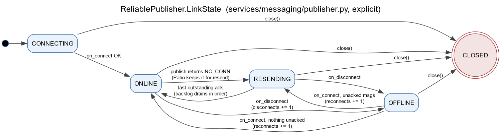
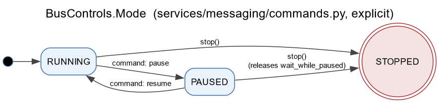
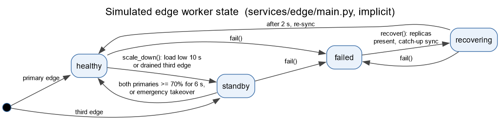

# Explicit state machines, class diagrams and small fixes

This branch does four things:

1. It turns the two implicit state machines in `services/messaging` into explicit ones.
2. It removes duplicated code in the messaging package and its tests.
3. It fixes three serious bugs in other components.
4. It adds generated class diagrams and state diagrams under [diagrams/](diagrams/).

Behaviour is unchanged except for the three bug fixes in the "Fixes outside the messaging package" section.

## Verification

| Run | Before | After |
|---|---|---|
| Full suite, no live services (`python -m pytest -q`) | 486 passed, 19 skipped | 487 passed, 19 skipped (one new test) |
| Messaging and broker-auth suites against live Mosquitto brokers | 167 passed, 1 skipped | 168 passed, 1 skipped |
| `ruff check` / `ruff format --check` on `services/messaging` | 1 import-order error | clean |

The live run used three throwaway `eclipse-mosquitto:2` containers:

- **Plain broker:** `EDGE_LIVE_MQTT_*`.
- **Restartable broker:** `MQTT_RESTART_*`.
- **Secured broker** with passwords and ACLs: `MQTT_SECURE_*`.

One secured-broker test failed before any change. The local, git-ignored `infrastructure/mosquitto-secure/acl` was generated before failover let an edge publish for every bus in its region. Regenerating that file fixed it; no code change was needed. If you see `test_edge_may_publish_states_only_within_its_region` fail, regenerate the ACL.

The skipped test is `test_auth_edge_server.py:279`. It needs separate authenticated-edge settings and was skipped both before and after.

## Messaging package (`services/messaging`)

### Publisher connection: `LinkState`

`ReliablePublisher` used to track its connection with four interacting fields: `_connected`, `_connections`, `_resend_pending` and `_closing`. The publish-ordering rule depended on their combination, and that combination was hard to read. They are now one enum and a transition table in [publisher.py](../services/messaging/publisher.py):

| State | Meaning | New messages |
|---|---|---|
| `CONNECTING` | before the first successful connection | wait in the backlog |
| `ONLINE` | connected, nothing older owed | go straight to Paho |
| `RESENDING` | connected, Paho still resending older unacknowledged messages | wait in the backlog |
| `OFFLINE` | connection lost, Paho reconnecting | wait in the backlog |
| `CLOSED` | `close()` called; final | wait in the backlog (never sent) |



**Illegal transitions.** An illegal transition is logged and ignored rather than raised. Paho re-raises exceptions from callbacks and would stop its network thread. A late `on_connect` after `close()` therefore cannot reopen the publisher.

**Small behaviour change.** On reconnect, the publisher now enters `RESENDING` whenever any message is still unacknowledged. Before, it used a flag that a narrow race could leave unset: the link drops between the state check and `client.publish()`, and Paho returns success. The new rule is the safer of the two and matches the documented intent.

**New test.** `test_link_state_machine` drives the publisher through `RESENDING → OFFLINE → RESENDING → ONLINE → CLOSED`. It also checks that a late connect does not leave `CLOSED`.

### Bus simulation mode: `BusControls.Mode`

`_paused` and `_stopped` were two booleans. They are now one `Mode` (`RUNNING`, `PAUSED`, `STOPPED`) with a `MODE_AFTER` table for `pause` and `resume`. `STOPPED` is final, so a late `resume` cannot restart a bus that is shutting down. The test `test_stop_releases_a_paused_bus` now covers this.



### Less duplication

**Validators in [commands.py](../services/messaging/commands.py).** Two copies of a numeric range validator became one `check(name, value)` driven by a `RANGES` table. `BusControls.apply` now looks the setting up from the existing `PARAMETERS` table instead of using an if/elif chain. The error messages are unchanged.

**Test helper.** Five test files each built the same 18-line telemetry dict. They now call `support.reading(sequence, **overrides)` from [tests/support.py](../services/messaging/tests/support.py). Each file passes the same field values as before.

**Net size.** `services/messaging` is 251 lines → 245 lines. The new state tables cost about as much as the removed duplication saved. The code was not bloated to begin with; the gain is readability, not size.

## Fixes outside the messaging package

Only problems with a concrete failure were changed. Each fix is one to three lines.

| File | Problem | Fix |
|---|---|---|
| [passenger.js](../frontend/js/passenger.js), [operator.js](../frontend/js/operator.js) | Bus status text from telemetry was inserted into HTML unescaped. A compromised bus could run a script in every passenger's browser and in the operator's logged-in session. | `escapeHtml(bus_status)`, using the existing helper |
| [scheduling.py](../services/central/scheduling.py) | A pending recommendation older than 30 s was never refreshed while demand stayed high, but `approve()` rejects anything older than 30 s. The operator saw an Approve button that always failed. | Refresh a pending decision once it is older than 30 s |
| [central/main.py](../services/central/main.py) | `poll_loop` and `simulation_loop` ran blocking work on the asyncio event loop. While the simulation lock was held, every request froze, including failover. | `await asyncio.to_thread(...)` for both |

**Reported but not changed:**

- **Default operator credentials.** `routers/auth.py` falls back to a built-in operator password when `OPERATOR_PASSWORD` is unset. Changing it would break the demo setup, so it is listed under Limitations in the report.
- **Ownership split after a central restart.** This was suspected but is not a bug. `mqtt_client.on_connect` republishes every region's assignment on each connect, which overwrites the stale retained message.

## Implicit state machines in the rest of the code

No other component has an explicit state machine. Their states are status strings, booleans, counters and timestamps changed in several places. The main ones are drawn from the code as it behaves, not from the report's prose:

| Machine | Where | States | Notes |
|---|---|---|---|
| Edge / sensor liveness | `shared/schema/health.py` `HeartbeatTracker` | unknown, healthy, recovering, unavailable | Derived on every read. A never-seen edge goes straight from unavailable to healthy and skips the recovery window. |
| Edge worker lifecycle | `services/edge/main.py`, `edge_server.py` | healthy, standby, failed, recovering | `state` is written at about 12 sites. `scale_down()` and `configure(active=False)` can move a failed or recovering worker to standby, which skips the recovery checks. |
| Third-edge load balancing | `services/edge/main.py` | armed, timing, disarmed | Triggers when both primaries are at 70% or more for 6 s. |
| Demand decision | `services/central/scheduling.py` | none, pending, applied | The stuck-pending case is fixed on this branch. |
| Edge workload | `services/central/health.py` | unknown, normal, high_load, overloaded | A pure function of status, utilisation and a timer. |
| Bus phase | `services/data_simulation/generate_data.py` `DemoFleet` | travelling, arriving, stopped, boarding, departing, out_of_service | `bus_status` has three producers with different vocabularies. |



**Suggested next step.** Give the edge worker a single `transition(worker, to, reason)` function with a table like the publisher's. It would reject the failed/recovering → standby paths. That rejection is a behaviour change, so it should be its own reviewed change.

## Diagrams

The [diagrams/](diagrams/) folder holds two kinds of diagram:

- **Class diagrams** (`classes_*.png`), one per tier, generated with pyreverse (pylint 4.1).
- **State diagrams** (`state_*.png`), written by hand in Graphviz from the code.

The `.dot` source of each diagram is kept next to it.

To regenerate a class diagram:

```text
pip install pylint
pyreverse -o dot -p messaging -my --colorized -d docs/diagrams services/messaging/[a-z]*.py
dot -Tpng -Gdpi=90 -Gpack=true -Gpackmode=array_u4 docs/diagrams/classes_messaging.dot -o docs/diagrams/classes_messaging.png
```

`services/messaging` has no `__init__.py`, so pass pyreverse the module files rather than the folder. The `pack` options lay the classes out as a grid instead of one long row. Few associations appear between classes because the components talk through functions, MQTT topics and JSON schemas rather than object references.
